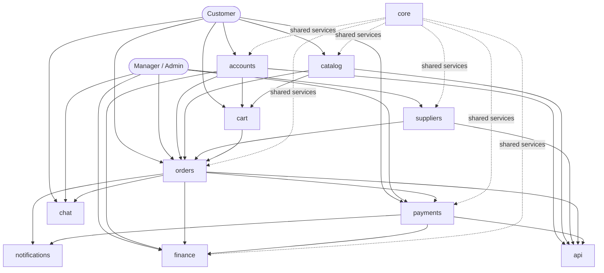
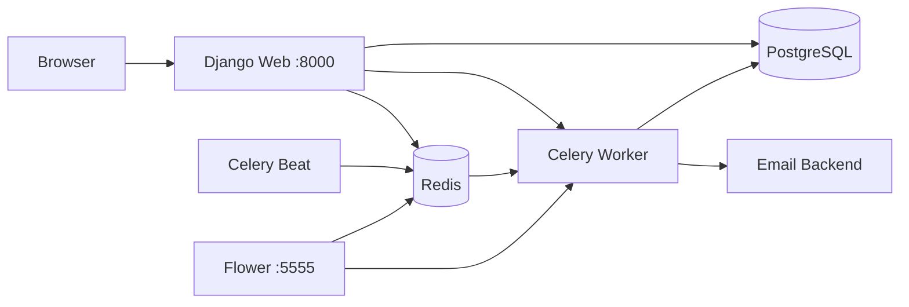

<div align="center">

# ⚡ Shop_ePower

### A modular B2B/B2C platform for electrical equipment

A Django platform being developed for wholesale and retail workflows:
**catalog → cart → checkout → stock reservation → manager workflow → notifications → history**

Confirmed money receipts and optional invoices are separate workflows.

<br>


[](https://github.com/asmpc/Shop_ePower/actions/workflows/ci.yml)


</div>

---

## 🚀 Project Overview

**Shop_ePower** is a Django platform for wholesale and retail electrical equipment sales, developed through small, tested changes.

Rather than being a simple online store, Shop_ePower is evolving into a modular business platform. Independent business domains cooperate through well-defined services, allowing the system to grow without large-scale rewrites.

The platform includes catalog and supplier inventory, stock reservation, order processing, payment status and invoice workflows, customer support chat, REST APIs, customer financial accounts, asynchronous notifications and Docker infrastructure.

PHASE 22 established the financial core. PHASE 23 now includes order-to-account
linking, checkout without automatic payments, multiple receipts per order,
an atomic receipt-credit service, and order-based invoices with cancellation
and retained history. Pre-shipment fund-assignment services use FIFO deposit
sources and support whole-assignment release and automatic release on
authorized order cancellation. Staff money-operation interfaces,
full-shipment settlement, post-shipment assignment/removal and actual
cash/bank refunds remain in progress. The priority path is PHASE 23 → minimal
1C integration → a controlled online test pilot without real sales or live payments.

---

## 🎯 Project Vision

The long-term vision is to evolve Shop_ePower into a complete business platform combining:

- e-commerce;
- inventory management;
- customer financial accounts;
- reverse logistics;
- ERP integrations;
- real-time communication;
- scalable cloud-ready architecture.

See the [development roadmap](docs/roadmap.md) for completed phases, current work and deferred capabilities.

---

## 🔥 Business Workflow

```text
                              CUSTOMER
                                  │
                                  ▼
                         PRODUCT CATALOG
                                  │
                                  ▼
                          SHOPPING CART
                                  │
                                  ▼
                              CHECKOUT
                                  │
                                  ▼
                          ORDER CREATION
                                  │
              ┌───────────────────┼───────────────────┐
              ▼                   ▼                   ▼
      STOCK RESERVATION     MANAGER WORKFLOW     CUSTOMER CHAT
              │                   │
              ▼                   │
       SUPPLIER STOCK             │
                    ┌─────────────┼───────────────────┐
                    ▼             ▼                   ▼
            OPTIONAL INVOICE  RECEIPT SERVICE     NOTIFICATIONS
                    │             │
                    ▼             ▼
             PDF + HISTORY   PAYMENT + ACCOUNT CREDIT
```

Checkout records the customer's financial account and payment preference,
but creates no payment or invoice. An invoice is an optional document issued
from the order, not proof of payment. The implemented receipt service records
actual office or bank funds as a confirmed payment and account credit in one
atomic operation; its staff website/API interface remains to be connected.
The implemented pre-shipment assignment service separately reserves an
explicit amount for an order from eligible FIFO deposit portions, without
creating debt. Whole-assignment release and authorized order cancellation
restore available funds while preserving history. These services are not
yet connected to dedicated staff money-operation forms or API actions.
Settlement at full shipment remains planned; receipt or invoice creation
does not automatically assign funds or settle debt.

---

## ✨ Key Features

<table>
<tr>
<td width="50%" valign="top">

### 🛍️ Product Catalog

- Categories and brands
- Product image gallery
- Product variants
- Search, filtering and sorting
- Pagination with preserved filters
- Dynamic pricing
- BYN, RUB and USD display
- Public inventory information
- Own-stock and supplier-stock separation
- Supplier lead-time display

</td>
<td width="50%" valign="top">

### 👤 Customer Accounts

- Email-based authentication
- Customer, manager and administrator roles
- Customer profile management
- Individual customer support
- Legal entity profile support
- Explicit personal account creation during registration
- Legal account creation and tax-ID snapshot validation
- Profile completeness validation
- Secure redirect back to the original workflow
- JWT authentication for REST API

</td>
</tr>

<tr>
<td width="50%" valign="top">

### 🛒 Shopping & Checkout

- Persistent shopping cart
- Cart merge after authentication
- Price snapshots
- Checkout validation
- Required existing personal or legal financial account
- Payment preference stored on the order; no automatic payment or invoice
- Pickup and shipping workflows
- Delivery provider and address
- Customer and delivery comments
- Guest checkout onboarding flow
- Temporary online-payment restriction

</td>
<td width="50%" valign="top">

### 📦 Order Management

- Order status workflow
- Persistent link to the owner's financial account
- Customer data snapshots
- Legal entity snapshots
- Automatic stock reservation
- Oversell protection
- Manager order processing
- Delivery updates
- Controlled cancellation workflow
- Reservation rollback after cancellation
- Pre-shipment fund-assignment services with traceable FIFO deposit portions
- Whole-assignment release and automatic fund release on authorized cancellation
- Customer and manager order views
- Paginated lists with preserved filters and return links
- New and processing orders shown by default; history through explicit filters

</td>
</tr>

<tr>
<td width="50%" valign="top">

### 💳 Payments & Invoices

- Multiple payment receipts per order
- Service for confirmed office/bank receipts with atomic, idempotent account credits
- Separate checkout preference, actual receipt and invoice workflows
- Online method retained in the model; live provider integration deferred
- Pending, paid and cancelled statuses; legacy pending/mock flows retained
- Immutable payment history
- Manager payment actions
- Administrator-only legacy resets; credited receipts protected from reset
- Invoice issuance from an order without a payment
- One issued invoice per order, enforced by a database constraint
- Cancellation and reissue with retained documents and distinct numbers
- PDF generation with ReportLab
- Owner-checked client invoice data/PDF access without a payment
- Invoice issuance and cancellation by managers and administrators on the website and API
- Required cancellation reason, actor and time
- Staff invoice history: pages of 20, PDF links and preserved return context
- Staff payment search by order, transaction ID or customer email
- Paginated staff payment results loaded after a search or filter

</td>
<td width="50%" valign="top">

### 💬 Communication

- Order-created email notifications
- Asynchronous Celery delivery
- Automatic retry and backoff
- Customer–manager chat rooms
- Free-room manager workflow
- Manager assignment
- File attachments
- Unread counters
- Customer room closing
- Paginated room lists with preserved filters and return links
- Closed rooms with unread messages remain visible to the relevant recipient

</td>
</tr>

<tr>
<td width="50%" valign="top">

### 🏢 Suppliers & Inventory

- Internal warehouse support
- External supplier support
- Supplier products
- Supplier prices and currencies
- Active/inactive inventory records
- Public inventory aggregation
- Detailed manager inventory
- Minimum lead-time calculation
- Multi-source stock reservation

</td>
<td width="50%" valign="top">

### 🔌 REST API

- Django REST Framework
- JWT login, refresh and logout
- Swagger / OpenAPI documentation
- Catalog endpoints
- Supplier endpoints
- Client order endpoints
- Manager order endpoints
- Client payment endpoints
- Manager payment actions
- Payment history endpoints
- Invoice and PDF endpoints
- Order-based invoice creation and role-checked cancellation
- Client invoice data/PDF endpoints addressed by invoice ID, not payment ID

</td>
</tr>
<tr>
<td colspan="2" valign="top">

### 💰 Customer Financial Core

- Separate personal and legal customer accounts
- Available funds and debt balance projections
- Account status lifecycle with audit history
- Atomic ledger creation and balance updates with account locking
- Idempotent operation keys and conflicting-retry validation
- Core services for deposits, debt, fund assignment, allocations, refunds and reversals
- Order-assignment and deposit-source records with positive-amount/uniqueness constraints
- Pre-shipment assignment and reversal-based release without creating debt
- Validation of amounts, actor information and resulting balances
- Read-only Django admin and staff website finance pages
- Account search, transaction journal and paginated account history
- Explicit account creation and legal-profile updates through services

Confirmed manual receipts can credit the account through an atomic service.
Pre-shipment assignment and whole-release services retain source portions
and append-only reversal history; staff and customer order cancellation
release active assignments under their existing order permissions.
Dedicated staff receipt/assignment interfaces, full-shipment settlement,
post-shipment assignment/removal, actual manual cash/bank refunds and
customer-facing balances remain PHASE 23 work. The core refund service is
not a real money-out payout workflow.

</td>
</tr>
</table>

---

## 🏗️ Architecture

Shop_ePower uses modular Django applications. Each application owns a specific business responsibility, while services and selectors keep business rules separate from presentation and transport layers.

### Application Responsibilities

| Application | Responsibility |
|---|---|
| `accounts` | Users, roles, authentication, customer profiles and legal entities |
| `catalog` | Products, categories, brands, images, variants and public catalog |
| `suppliers` | Suppliers, supplier products, warehouse and external inventory |
| `cart` | Shopping cart, cart items and price snapshots |
| `orders` | Checkout, orders, stock reservation, delivery, fund-assignment sources and release on cancellation |
| `payments` | Confirmed receipt services, legacy payment transitions, invoice lifecycle, history and PDF generation |
| `finance` | Personal and legal financial accounts, transaction ledger, atomic balance services, status history and staff finance views |
| `notifications` | Email services and asynchronous notification tasks |
| `chat` | Rooms, messages, attachments, assignment and unread state |
| `api` | REST API endpoints, serializers and permissions |
| `core` | Shared currency, pricing, settings, utilities and infrastructure |

### Application Architecture



### Infrastructure Architecture



### Design Principles

- Clear separation of business domains
- Thin views and API views
- Service-layer commands for business operations
- Selectors for optimized read operations
- Snapshot data for historical integrity
- Explicit permissions for client, manager and administrator roles
- Celery tasks as thin orchestration functions
- Primitive identifiers passed through task queues
- `transaction.on_commit()` for post-transaction tasks
- Regression tests for every discovered production-like issue
- Technical debt documented instead of hidden

---

## 🧭 Design Principles

The project follows a small set of engineering principles.

- **Business First** — business requirements drive architecture.
- **Evolution over Revolution ⭐** — existing, working components are evolved instead of rewritten. New functionality extends the current architecture while preserving stability whenever practical.
- **Test Driven Development** — new functionality is protected by automated tests.
- **Clean Architecture** — business logic belongs in services and domain layers.
- **Domain Separation** — each application owns a single business responsibility.
- **Documentation First** — documentation evolves together with the code.
- **CI Before Merge** — important changes should pass automated validation.
- **One Logical Sprint = One Commit** — each completed sprint ends with a meaningful Git commit.

---

## ⚙️ Technology Stack

| Layer | Technologies |
|---|---|
| Language | Python 3.14 |
| Web Framework | Django 6.0.5 |
| Dependency Management | Poetry and poetry.lock |
| REST API | Django REST Framework, Simple JWT |
| API Documentation | drf-spectacular, Swagger / OpenAPI |
| Database | PostgreSQL |
| Cache & Broker | Redis |
| Background Tasks | Celery |
| Scheduler | django-celery-beat |
| Monitoring | Flower |
| PDF Generation | ReportLab |
| Frontend | Django Templates, Bootstrap, JavaScript |
| Infrastructure | Docker, Docker Compose |
| Testing | Django TestCase, DRF API tests, regression tests |
| Code Quality | Ruff |
| Version Control | Git, GitHub |
| Continuous Integration | GitHub Actions |
| Container Registry | GitHub Container Registry (GHCR) |

---

## 🚀 Quick Start with Docker

### 1. Clone the Repository

```bash
git clone https://github.com/asmpc/Shop_ePower.git
cd Shop_ePower
```

### 2. Create the Environment File

Linux / macOS:

```bash
cp .env.example .env
```

Windows PowerShell:

```powershell
Copy-Item .env.example .env
```

Update the values in `.env` before starting the project.

### 3. Build the Image and Start PostgreSQL / Redis

```bash
docker compose build
docker compose up -d --wait postgres redis
```

### 4. Apply Database Migrations

```bash
docker compose run --rm --no-deps web python manage.py migrate
```

### 5. Start the Full Stack

```bash
docker compose up -d --wait
```

Applying migrations before starting all application services allows the
web health check to succeed on a fresh database.

### 6. Create a Django Administrator

```bash
docker compose exec web python manage.py createsuperuser
```

Application roles (`CLIENT`, `MANAGER`, `ADMIN`) are separate from Django's
staff and superuser flags. Assign the appropriate application role through
the user form in Django admin to access staff pages on the website.
Customer registration and legal-profile services create financial accounts;
manually created demonstration users may require explicit account setup
before checkout.

### 7. Open the Application

| Service | Address |
|---|---|
| Shop | <http://127.0.0.1:8000/shop/> |
| Django Admin | <http://127.0.0.1:8000/admin/> |
| Swagger / OpenAPI | <http://127.0.0.1:8000/api/schema/swagger-ui/> |
| Flower | <http://127.0.0.1:5555> |

---

## 🐳 Docker Compose Services

| Service | Purpose | Host Port |
|---|---|---:|
| `web` | Django development web server | `8000` |
| `postgres` | PostgreSQL database | `5433` |
| `redis` | Celery broker and result backend | `6380` |
| `celery_worker` | Background task execution | — |
| `celery_beat` | Database-backed periodic task scheduler | — |
| `flower` | Celery monitoring dashboard | `5555` |

The application services use one shared Docker image with different startup commands.

Persistent Docker volumes preserve:

- PostgreSQL data;
- Redis data.

The development bind mount:

```yaml
./src:/app/src
```

allows source-code and template changes to appear inside the running container without rebuilding the image.

---

## 🔧 Useful Commands

### Environment

```bash
docker compose up -d
docker compose ps
docker compose restart
docker compose down
```

### Logs

```bash
docker compose logs -f web
docker compose logs -f celery_worker
docker compose logs -f celery_beat
docker compose logs -f flower
```

### Django

```bash
docker compose exec web python manage.py check
docker compose exec web python manage.py showmigrations
docker compose exec web python manage.py makemigrations
docker compose exec web python manage.py migrate
docker compose exec web python manage.py createsuperuser
docker compose exec web python manage.py shell
```

### Tests

```bash
docker compose exec web python manage.py test
```

Run a specific test module:

```bash
docker compose exec web python manage.py test shop_epower.catalog.tests.test_product_list_inventory
```

### Celery

```bash
docker compose exec celery_worker celery -A config inspect ping
docker compose exec celery_worker celery -A config inspect registered
docker compose exec celery_worker celery -A config inspect active
```

### Local Poetry Environment

Run these commands from the repository root after configuring `.env` and
making PostgreSQL and Redis available to the local application:

```bash
poetry install --no-root
poetry run python src/manage.py check
poetry run python src/manage.py makemigrations --check --dry-run
poetry run ruff check src
poetry run python src/manage.py test
```

When working inside `src`, use `manage.py` instead of `src/manage.py`.
The application Docker image installs runtime dependencies; local Poetry
and the CI quality job also install the development tools.

More commands and troubleshooting instructions are available in [`docs/docker.md`](docs/docker.md).

---

## 🌐 REST API

The project exposes client, manager and administrator workflows through Django REST Framework.

### Main API Areas

- authentication and JWT tokens;
- product catalog;
- suppliers and supplier products;
- client checkout and orders;
- manager order processing;
- client payments;
- manager payment actions;
- payment history;
- invoice details;
- PDF invoice downloads;
- invoice creation by order ID, and client document/PDF access by invoice ID;
- invoice cancellation by managers and administrators with a required reason.

Swagger / OpenAPI documentation is available at
[`/api/schema/swagger-ui/`](http://127.0.0.1:8000/api/schema/swagger-ui/),
with the schema at [`/api/schema/`](http://127.0.0.1:8000/api/schema/).

---

## 🧪 Testing

Shop_ePower is developed with a strong automated-testing focus.

The latest verified full run passed **720 tests on 2026-10-17**. Tests run
against an isolated PostgreSQL test database. GitHub Actions is configured
to execute the full suite on pushes to `dev` and `main`, and on pull requests
targeting `main`.

Scoped checks for the new pre-shipment assignment/release services and
existing order-cancellation workflows, together with Ruff, passed on
2026-10-18. A fresh full-project regression for this block is pending;
the full-run count above is unchanged.

The test suite covers:

- Django models;
- selectors;
- service-layer business rules;
- frontend views;
- checkout and profile workflows;
- stock reservation and rollback;
- payment transitions;
- financial account lifecycle, ledger entries and balance projections;
- idempotency, allocation limits, reversals, rollback and concurrent operations;
- permissions;
- invoice lifecycle;
- PDF responses;
- REST API endpoints;
- asynchronous notification integration;
- regression scenarios found during manual testing.

Examples of protected regressions include:

- profile completion before checkout;
- secure redirect through the `next` parameter;
- inventory quantity and supplier lead time in catalog cards;
- payment state-transition validation;
- administrator-only legacy reset and protection of financially credited receipts;
- checkout without an automatic payment, actual receipt registration and idempotent account credits;
- order-based invoice issuance without payment, cancellation and reissue;
- client invoice/PDF ownership checks and paginated staff invoice history;
- order-to-account linking and rejection of checkout without the matching account;
- FIFO funding portions, active-use limits and idempotent pre-shipment assignment;
- whole-assignment release, retained history and reuse of released funds;
- automatic release on authorized staff/customer order cancellation and rollback on failure;
- list pagination, preserved filters and safe return navigation;
- unread-message visibility and closed-room behavior by role.

---

## ✅ Continuous Integration

Shop_ePower uses GitHub Actions as an automated quality gate.

```text
Push to dev / main OR pull request to main
                    │
          ┌─────────┴─────────┐
          ▼                   ▼
      Django CI          Ruff Quality
  PostgreSQL / Redis     Poetry + Ruff
  Checks + migrations
  Full test suite
          │                   │
          └─────────┬─────────┘
                    ▼
             Docker image build
                    │
                    ▼
      Image checks + container smoke test
                    │
                    ▼
       Full Docker Compose integration
                    │
                    ▼
      GHCR publishing on push events only
```

The CI workflow currently provides:

- execution on pushes to `dev` and `main`;
- execution for pull requests targeting `main`;
- Python 3.14 setup;
- Poetry installation and dependencies from the lock file;
- isolated PostgreSQL and Redis service containers;
- service health checks;
- Django configuration validation;
- real PostgreSQL and Redis connection checks;
- protection against forgotten migrations;
- execution of the full automated test suite;
- a separate Ruff quality job;
- a Docker build after the test and quality jobs succeed;
- Docker layer caching through GitHub Actions;
- Django checks and a container smoke test;
- full Compose startup with migrations, web, Flower, worker and Beat checks;
- image publishing to GHCR on pushes, with `dev`, `latest` and commit tags
  according to the branch.

The workflow is stored in:

```text
.github/workflows/ci.yml
```

Image publishing is already configured. Deployment automation remains later
work; the immediate delivery target is the controlled test pilot after
PHASE 23 settlement integration and PHASE 24 minimal 1C exchange.

---

## 📚 Documentation

Technical documentation is stored in the [`docs/`](docs/) directory.

| Document | Description |
|---|---|
| [`docs/docker.md`](docs/docker.md) | Docker commands, logs, diagnostics and daily workflow |
| [`docs/architecture.md`](docs/architecture.md) | Current project and infrastructure architecture |
| [`docs/deployment.md`](docs/deployment.md) | Production deployment plan |
| [`docs/github-actions.md`](docs/github-actions.md) | Current CI workflow and future CI/CD plan |
| [`docs/roadmap.md`](docs/roadmap.md) | Master development roadmap |
| [`docs/phase-22-customer-financial-core.md`](docs/phase-22-customer-financial-core.md) | Financial core rules and completed PHASE 22 work |
| [`docs/phase-23-deposits-and-order-settlement.md`](docs/phase-23-deposits-and-order-settlement.md) | Current order funds and shipment settlement design |

Documentation records both implemented behavior and planned work. The
roadmap and current phase plan identify the remaining integration tasks.

---

## 📈 Project Status

### ✅ Completed

- Catalog, pricing, suppliers and inventory
- Customer profiles, authentication and authorization roles
- Shopping cart, checkout, orders and stock reservations
- Delivery, cancellation and reservation rollback
- Payment status workflows, invoices and PDF documents
- Email notifications and customer–manager chat
- Client and staff REST APIs
- Poetry dependency management and shared test helpers
- Ruff quality checks
- Docker Compose infrastructure
- GitHub Actions checks, Docker integration tests and GHCR publishing
- PHASE 22: personal and legal financial accounts, atomic financial
  services, transaction ledger and account status history
- Read-only staff finance pages with search, filters and pagination
- Paginated order and chat lists with preserved navigation
- New orders linked to the owner's matching financial account
- Website/API checkout stores a payment preference without creating a payment
- Multiple receipts per order and an atomic manual receipt-credit service
- Pre-shipment assignment/release services with FIFO sources and retained history
- Automatic fund release during authorized customer and staff order cancellation
- Order-based invoice issuance, staff cancellation and reissue with retained history
- Payment-independent client invoice data/PDF access and paginated staff history
- Removal of active failed-payment paths; historical data preserved
- Full suite of 720 tests passed on 2026-10-17

### 🚧 Current Work

**PHASE 23 — Order Funds & Full-Shipment Settlement**

The account link, receipt-service foundation, website/API invoice block,
and pre-shipment assignment/release services are implemented. New orders
require the matching financial account; invoices do not require a payment
and do not themselves change funds or debt. Existing authorized order
cancellation now releases active assignments atomically.

Remaining work includes staff interfaces for receipt registration and
assignment/removal, post-shipment assignment and debt restoration,
pre-shipment order editing, shipment records and settlement, safe receipt
corrections, concurrent-workflow verification, actual manual cash/bank refunds,
customer balance views and shipped-but-unpaid order lists.

Receipt confirmation, assigning funds to an order, shipment settlement and
real payout are separate actions. Existing debt allocation cannot substitute
for pre-shipment assignment. Before order-item editing, preserve invoice-item
snapshots so historical PDFs cannot change with the order.

### 🗺️ Next Milestones

- PHASE 24: minimal 1C integration using an agreed exchange contract
- PHASE 25: an internet-accessible test pilot without real sales or live payments

Further capabilities remain in the [roadmap](docs/roadmap.md), including
partial shipments, external payment providers, goods-return logistics, caching,
internationalization and WebSocket communication.

---

## 🛣️ Engineering Roadmap

```text
COMPLETED
   ├── PHASE 20 — Poetry and dependency modernization
   ├── PHASE 21 — Shared test helpers and Ruff
   └── PHASE 22 — Customer financial core
        │
        ▼
PHASE 23 — Order funds and full-shipment settlement 🚧
        │
        ▼
PHASE 24 — Minimal 1C integration
        │
        ▼
PHASE 25 — Controlled online test pilot
           No real sales or live payments
        │
        ▼
FURTHER DEVELOPMENT
   Prioritized from pilot feedback and business needs
   See docs/roadmap.md
```

---

## 👨‍💻 Project

Shop_ePower is a personal diploma project created and developed by **Alexander Morozov**.

The project has been built through an iterative engineering process with extensive architectural discussions, code reviews, technical planning, and development support provided by ChatGPT.

The primary goals of this project are:

- applying modern Django engineering practices;
- learning to make architectural decisions instead of copying solutions;
- designing a scalable and maintainable system;
- following Test-Driven Development;
- mastering Docker, PostgreSQL, Redis and Celery;
- creating a strong foundation for continued development after graduation.

---

<div align="center">

## ⚡ Thank You for Visiting Shop_ePower

**The diploma defense is a milestone — not the end of the project.**

Shop_ePower will continue to evolve as a long-term engineering and portfolio project.

</div>
