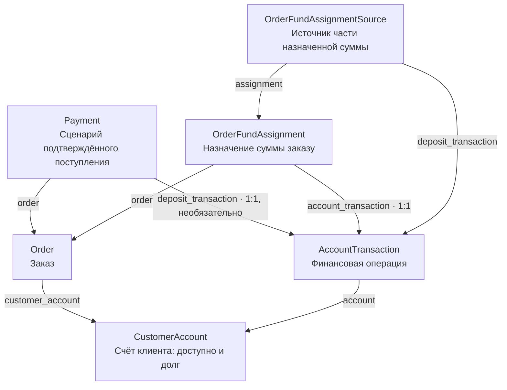
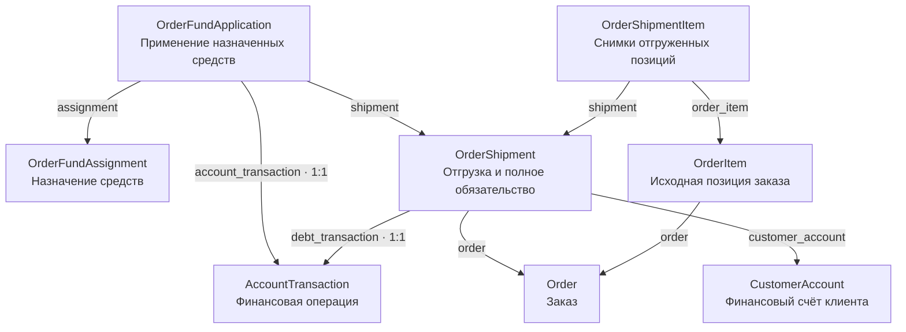
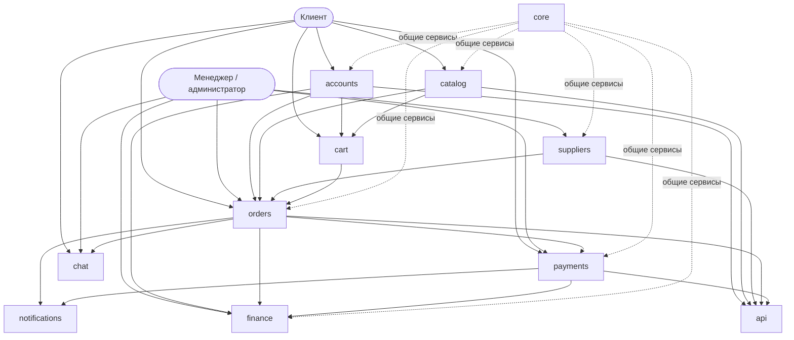
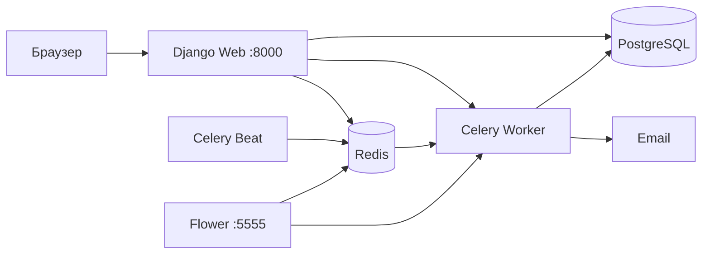

<div align="center">

# ⚡ Shop_ePower

### Модульная B2B/B2C-платформа для электротехнической продукции

**Русский | [English](docs/README.en.md)**

Django-платформа для оптовых и розничных сценариев:

**каталог → корзина → оформление → резерв товара → работа менеджера → уведомления → история**

Подтверждённое поступление денег и необязательный счёт на оплату — разные процессы.

<br>


[](https://github.com/asmpc/Shop_ePower/actions/workflows/ci.yml)

</div>

---

Последний полный прогон: **796 тестов прошли 2026-10-20**.
Последующие изменения регистрации поступлений проверены адресными модулями,
Ruff и вручную; состояние проекта обновлено 2026-10-22.

## Обзор проекта

Shop_ePower — Django-платформа для продажи электротехнической продукции,
которую мы развиваем небольшими проверяемыми изменениями. Отдельные
бизнес-модули взаимодействуют через сервисы, позволяя постепенно
расширять систему.

Уже есть каталог и остатки поставщиков, резервирование, обработка заказов,
статусы оплат и счета, чат поддержки, REST API, финансовые счета клиентов,
асинхронные уведомления и Docker-инфраструктура.

Фаза 22 создала финансовое ядро. В фазе 23 уже есть привязка заказов к
соответствующим счетам клиента, оформление без автоматического платежа,
несколько поступлений одного заказа, атомарный сервис поступления и
пополнения, выписка Invoice по заказу, аннулирование и сохранение истории.
Сервисы назначения средств до отгрузки уже используют FIFO-источники,
поддерживают полную отмену назначения и освобождение денег при разрешённой
отмене заказа. Атомарный расчёт при полной отгрузке подключён к завершению
через сайт/API. Сервисы назначения и снятия оплаты после отгрузки тоже
реализованы. Регистрация поступления на сайте подключена; формы назначения/
снятия, API поступлений и реальные возвраты наличных/безнала ещё впереди.
Приоритетный путь: фаза 23 → минимальный обмен с 1С →
контролируемый тестовый запуск в интернете без реальных продаж и оплат.

## Долгосрочная цель

Платформа должна объединить электронную торговлю, управление запасами,
финансовые счета клиентов, возвратную логистику, ERP-интеграции,
общение в реальном времени и масштабируемую архитектуру.

Согласованные приоритеты и отложенные возможности перечислены в
[плане развития проекта](docs/roadmap.md).

## Бизнес-процесс

```text
                              КЛИЕНТ
                                 │
                                 ▼
                              КАТАЛОГ
                                 │
                                 ▼
                              КОРЗИНА
                                 │
                                 ▼
                            ОФОРМЛЕНИЕ
                                 │
                                 ▼
                              ЗАКАЗ
                                 │
              ┌──────────────────┼───────────────────┐
              ▼                  ▼                   ▼
         РЕЗЕРВ ТОВАРА      РАБОТА МЕНЕДЖЕРА      ЧАТ КЛИЕНТА
              │                  │
              ▼                  │
       ОСТАТКИ ПОСТАВЩИКА        │
                   ┌─────────────┼───────────────────┐
                   ▼             ▼                   ▼
             СЧЁТ НА ОПЛАТУ  СЕРВИС ПОСТУПЛЕНИЯ    УВЕДОМЛЕНИЯ
             (НЕОБЯЗАТЕЛЕН)      │
                   │             ▼
                   ▼        ПЛАТЁЖ + ПОПОЛНЕНИЕ БАЛАНСА
             PDF + ИСТОРИЯ
```

Оформление сохраняет финансовый счёт клиента и выбранный способ оплаты,
но не создаёт платёж или Invoice. Invoice — необязательный документ по
заказу, а не доказательство оплаты. Реализованный сервис поступления
атомарно сохраняет фактические деньги офиса/безнала как подтверждённый
платёж и пополнение баланса; регистрация на сайте сотрудника подключена,
а API ещё впереди. Сервис назначения до отгрузки отдельно закрепляет
явную сумму за заказом из свободных FIFO-частей поступлений без создания
долга. Полная отмена назначения и разрешённая отмена заказа возвращают
доступные средства, сохраняя историю. Формы назначения/снятия и действия
API поступлений/назначений ещё не подключены. Полная отгрузка начисляет обязательство
и применяет только ранее назначенные средства; поступление или Invoice сами
не назначают деньги и не погашают долг.

## Основные возможности

### Каталог

- Категории и бренды, галереи изображений, варианты товаров.
- Поиск, фильтры, сортировка и пагинация с сохранением фильтров.
- Динамическое ценообразование и отображение BYN, RUB, USD.
- Публичная информация об остатках.
- Разделение собственного склада и запасов поставщиков.
- Отображение срока поставки.

### Пользователи и профили

- Вход по email и роли клиента, менеджера, администратора.
- Редактирование профиля и поддержка юридических лиц.
- Создание личного финансового счёта в сервисе регистрации.
- Создание юридического счёта и проверка снимка УНП/ИНН.
- Проверка заполненности профиля.
- Безопасное возвращение в исходный сценарий после заполнения профиля.
- JWT-аутентификация для REST API.

### Корзина и оформление

- Постоянная корзина и объединение корзин после входа.
- Снимки цен и проверки оформления.
- Требование существующего личного или юридического счёта.
- Сохранение способа оплаты в заказе без автоматического платежа или Invoice.
- Самовывоз, доставка, поставщик доставки и адрес.
- Комментарии клиента к заказу и доставке.
- Сценарий регистрации/входа перед оформлением для гостя.
- Временное ограничение онлайн-оплаты.

### Заказы

- Управление статусами заказа.
- Сохранённая связь со счётом владельца.
- Снимки пользовательских и юридических данных.
- Автоматические резервы и защита от продажи сверх остатка.
- Обработка менеджером и изменение данных доставки.
- Контролируемая отмена с возвратом резервов.
- Сервисы назначения средств до отгрузки с прослеживаемыми FIFO-источниками.
- Полная отмена назначения и освобождение средств при разрешённой отмене заказа.
- Клиентские и менеджерские страницы.
- Пагинация, сохранение фильтров и обратных ссылок.
- По умолчанию новые и обрабатываемые заказы; история — через явные фильтры.

### Оплаты и счета

- Несколько поступлений одного заказа.
- Сервис подтверждённых поступлений офиса/безнала с атомарным идемпотентным
  пополнением финансового счёта.
- Разделение выбора способа оплаты, фактического поступления и Invoice.
- Онлайн-метод сохранён в модели; подключение реального провайдера отложено.
- Статусы: ожидает, оплачено, отменено; старые pending/mock-сценарии сохранены.
- Неизменяемая история статусов.
- Действия менеджера; старый сброс статуса только администратором и защита
  зачисленных поступлений от такого сброса.
- Выписка Invoice по заказу без платежа; только один действующий документ
  на заказ, что защищено ограничением БД.
- Аннулирование и перевыпуск с сохранением старых документов и номеров.
- PDF через ReportLab; получение клиентом своего документа и PDF без платежа.
- Менеджер и администратор выписывают и аннулируют Invoice через сайт и API.
- Обязательная причина отмены, автор и время.
- История Invoice для сотрудников: по 20 записей, ссылки PDF и сохранение
  контекста возврата к списку заказов.
- Поиск сотрудником по заказу, ID операции или email клиента.
- Пагинация результатов; список загружается после поиска или выбора фильтра.

### Общение и уведомления

- Письма о созданном заказе через Celery.
- Повторные попытки отправки с увеличением интервала.
- Чаты клиента и менеджера, свободные комнаты и назначение менеджера.
- Вложения, счётчики непрочитанного и закрытие комнаты клиентом.
- Пагинация с сохранением фильтров и обратных ссылок.
- Закрытая комната с непрочитанным сообщением остаётся видна получателю.

### Поставщики и остатки

- Собственный склад и внешние поставщики.
- Товары поставщиков, цены и валюты.
- Активные и неактивные записи остатков.
- Агрегированная информация для клиента и подробная для менеджера.
- Минимальный срок поставки и резервирование из нескольких источников.

### REST API

- Django REST Framework и JWT: вход, обновление токена, выход.
- Swagger / OpenAPI.
- Каталог и поставщики.
- Заказы клиента и обработка заказов менеджером.
- Оплаты клиента, действия менеджера и история статусов.
- Выписка счёта по ID заказа; данные и PDF клиента по ID самого Invoice.
- Аннулирование менеджером и администратором с обязательной причиной.

### Финансовое ядро клиента

- Раздельные личные и юридические финансовые счета.
- Проекции доступных средств и долга.
- Статусы счёта и история их изменений.
- Атомарное создание финансовой операции и изменение балансов
  с блокировкой счёта.
- Идемпотентные ключи операций и проверка конфликтующих повторов.
- Базовые сервисы пополнения, долга, назначения, распределения, возврата и сторнирования.
- Записи назначения и частей поступлений с ограничениями положительной суммы и уникальности.
- Сервисы назначения и освобождения до отгрузки без создания долга.
- Проверки сумм, инициатора операции и результирующих балансов.
- Django admin и финансовые страницы сотрудников только для чтения.
- Поиск счетов, общий журнал и пагинация истории конкретного счёта.
- Явное создание счетов и изменение юрпрофиля через сервисы.

Подтверждённое ручное поступление может пополнять счёт через атомарный
сервис. Назначение и полная отмена до отгрузки сохраняют части источников
и историю сторнирования; отмена заказа сотрудником или клиентом освобождает
действующие назначения в рамках прав на заказ. Расчёт при полной отгрузке
подключён к существующему завершению. Сервисы назначения/снятия после отгрузки
погашают и восстанавливают долг выбранной отгрузки, сохраняя `COMPLETED`,
поступления и историю. Форма сайта регистрирует фактические деньги офиса/
безнала без автоматического назначения. Формы назначения/снятия, API
поступлений, реальные ручные возвраты и балансы клиента остаются задачами фазы 23.
Базовый сервис refund не является сценарием реальной выдачи денег клиенту.

<a id="order-funds-models"></a>

## Модели денег заказа и отгрузки

Состояние на 2026-10-22. Связи моделей и сервисы расчёта ниже
реализованы. Регистрация поступления на сайте подключена; формы назначения
и API регистрации поступлений ещё впереди.

### Поступление и назначение средств — реализовано

Стрелка направлена от модели с полем-ссылкой к связанной модели.
Это связи в базе данных, а не автоматическое движение денег.



- `Payment` фиксирует подтверждённое поступление в новом ручном сценарии.
  Связь с пополнением необязательна в схеме для старых записей; старый
  ожидающий платёж не доказывает, что деньги действительно получены.
- `OrderFundAssignment` сохраняет явно назначенную заказу сумму.
  Само поле `Payment.order` не назначает деньги и не погашает заказ.
- `OrderFundAssignmentSource` хранит использованные части поступлений.
  Для поступлений 40 и 60 назначение 70 имеет два FIFO-источника: 40 и 30.
  Доступно остаётся 30; до отгрузки долг не возникает.
- `AccountTransaction` — журнал финансовых операций, а `CustomerAccount`
  хранит текущие проекции доступных средств и долга. Сторнирование дополняет
  историю, а не удаляет назначения и их источники.

### Отгрузка и применение средств — полная отгрузка подключена

Модели `OrderShipment`, `OrderShipmentItem` и `OrderFundApplication` созданы.
На схемах показаны существующие связи. На 2026-10-20 общий сервис полной
отгрузки подключён к существующему завершению заказа через сайт и API.



`OrderShipment` сохраняет заказ, счёт, операцию начисления обязательства,
полную сумму, валюту, сотрудника и дату. Пока ограничение БД разрешает
одну отгрузку на заказ; сам `ForeignKey` оставляет основу для будущих
частичных отгрузок. Одно начисление долга нельзя связать с двумя отгрузками.

`OrderShipmentItem` сохраняет связь с исходной позицией заказа и отдельные
снимки названия, цены, количества, суммы и валюты. Количество положительное;
одна позиция заказа не повторяется внутри отгрузки. Независимое хранение
снимков реализовано; сервис отгрузки автоматически копирует позиции заказа.
Он проверяет непустой состав и сохранённый итог с учётом товаров и доставки
магазину. Само хранение снимков не запрещает прямые правки истории;
общая защита правок и отдельные конкурентные проверки ещё предстоят.

`OrderFundApplication` хранит `assignment`, `shipment`, `account_transaction`,
`amount` и `created_at`. Три теста модели и адресный Ruff прошли;
сумма положительная, финансовую операцию нельзя использовать повторно.
Назначение и отгрузка связаны
через `ForeignKey` с учётом будущих частичных отгрузок; финансовая операция —
через `OneToOneField`. Сервис должен проверять совпадение заказа, счёта и
валюты, доступную действующую сумму назначения и непогашенное обязательство
конкретной отгрузки.

### Реализованный пример расчёта при полной отгрузке

Для заказа на 100, поступления 100 и явного назначения 60:

| Действие | Тип AccountTransaction | Доступно | Долг |
|---|---|---:|---:|
| Подтвердили поступление | `DEPOSIT` | 100 | 0 |
| Назначили заказу 60 | `FUNDS_ASSIGNMENT` | 40 | 0 |
| Записали полную отгрузку на 100 | `DEBT_INCREASE` | 40 | 100 |
| Применили назначенные 60 | `FUNDS_APPLICATION` | 40 | 40 |

Это четыре типа записей одной модели `AccountTransaction`.
Полное обязательство берётся из сохранённого `Order.total_price`: доставка,
оплачиваемая магазину, включена; отдельная оплата перевозчику исключена.
Последние два шага должны фиксироваться атомарно, без отдельного сохранённого
промежуточного долга 100. Уже назначенные средства не списываются с доступного
баланса повторно. Старый `allocate_customer_funds()` уменьшает оба баланса
и не подходит для этого применения предоплаты.

`record_customer_funds_application()` реализован: изменение доступного
баланса равно нулю, изменение долга — минус положительная сумма.
Соответствие назначению должен обеспечивать сервис заказа/отгрузки;
низкоуровневая финансовая функция сама его не проверяет.
`Complete order` теперь вызывает `complete_order_shipment()`: отгрузка,
снимки позиций, полное обязательство, применение действующих назначений
до отгрузки и статус `COMPLETED` сохраняются атомарно. Разрешённый повтор
возвращает существующую отгрузку без повторного изменения денег. Отменённые
назначения исключаются; предел отгрузки не позволяет использовать чужие
обязательства счёта как дополнительную ёмкость погашения.
Сервисы назначения и снятия оплаты после отгрузки реализованы на 2026-10-22.
Для отгруженного заказа на 100 при доступных средствах 100 и долге 100
назначение 60 атомарно создаёт `FUNDS_ASSIGNMENT` и `FUNDS_APPLICATION`:
доступно становится 40, долг — 40. Полная отмена назначения добавляет две
операции `REVERSAL`, восстанавливая доступные средства и долг до 100.
Поступление, отгрузка и исходные записи назначения/применения сохраняются;
заказ остаётся в `COMPLETED`. Повторы с тем же ключом не меняют балансы повторно.
Регистрация поступления подключена к сайту; формы назначения/снятия,
API поступлений и отдельные конкурентные тесты ещё впереди.

### Подтверждение полной отгрузки — согласованные границы

Форма завершения на сайте теперь запрашивает явное подтверждение браузера: «Подтверждаете полную отгрузку заказа №…? После подтверждения
отменить отгрузку или изменить состав заказа на сайте нельзя».
При отмене диалога запрос завершения не отправляется и ничего не меняется.

В фазе 23 не реализуем исправление/повторное открытие подтверждённой отгрузки:
не добавляем действие исправления, сервис сторнирования отгрузки, состояние
исправленной записи или повторную отгрузку взамен ошибочной. Сохраняем
существующее ограничение «одна отгрузка на заказ», а не условие «одна
действующая». Реальный возврат товара — отдельный отложенный сценарий.
Ошибочно подтверждённую отгрузку штатно исправить на сайте в этих границах нельзя.

Диалог снижает риск случайного нажатия, но не защищает от намеренного обхода.
Серверные проверки прав, статуса и согласованности, блокировки, атомарность
и идемпотентность обязательны. Снятие назначения, исправление поступления
и фактические ручные возвраты остаются отдельными согласованными денежными
сценариями; они не открывают отгрузку повторно.

Границы реализации и оставшаяся работа — в
[плане фазы 23](docs/phase-23-deposits-and-order-settlement.md#order-funds-models).

## Архитектура

Каждое Django-приложение отвечает за отдельный бизнес-домен. Сервисы
и селекторы отделяют правила работы от страниц и API.

| Приложение | Ответственность |
|---|---|
| `accounts` | Пользователи, роли, вход, профили, юридические данные |
| `catalog` | Товары, категории, бренды, изображения, варианты, каталог |
| `suppliers` | Поставщики, их товары, собственные и внешние остатки |
| `cart` | Корзина, позиции и снимки цен |
| `orders` | Оформление, заказы, резервы, доставка, источники назначения и освобождение средств при отмене |
| `payments` | Сервисы поступлений, старые переходы статусов, жизненный цикл Invoice, история и PDF |
| `finance` | Финансовые счета, журнал, атомарные сервисы балансов, история статусов и страницы сотрудников |
| `notifications` | Email-сервисы и асинхронные задачи |
| `chat` | Комнаты, сообщения, вложения, назначение, непрочитанное |
| `api` | REST API, сериализаторы и разрешения |
| `core` | Общие валюты, цены, настройки и вспомогательные функции |

### Взаимодействие приложений



### Инфраструктура



### Принципы реализации

- Разделение бизнес-доменов и небольшие представления/API views.
- Бизнес-команды в сервисах, чтение данных в селекторах.
- Снимки данных для сохранения истории.
- Явные разрешения клиента, менеджера и администратора.
- Celery-задачи как небольшие функции координации.
- Передача идентификаторов через очередь задач.
- Запуск задач после успешной транзакции через `transaction.on_commit()`.
- Регрессионные тесты обнаруженных при ручных проверках проблем.
- Документирование технического долга.

## Инженерные принципы

- Бизнес-требования определяют архитектуру.
- Рабочие компоненты постепенно развиваются без полного переписывания.
- TDD и автоматические проверки новой функциональности.
- Бизнес-логика находится в сервисах и доменах.
- Каждый модуль отвечает за свою область.
- Документация развивается вместе с кодом.
- Важные изменения проходят CI перед слиянием.
- Один логический спринт завершается понятным Git-коммитом.

## Технологии

| Область | Технологии |
|---|---|
| Язык | Python 3.14 |
| Веб-фреймворк | Django 6.0.5 |
| Зависимости | Poetry и poetry.lock |
| REST API | DRF, Simple JWT |
| Документация API | drf-spectacular, Swagger / OpenAPI |
| База данных | PostgreSQL |
| Кеш и брокер | Redis |
| Фоновые задачи | Celery |
| Планировщик | django-celery-beat |
| Мониторинг | Flower |
| PDF | ReportLab |
| Интерфейс | Django Templates, Bootstrap, JavaScript |
| Инфраструктура | Docker, Docker Compose |
| Тесты | Django TestCase, DRF API-тесты, регрессионные тесты |
| Качество кода | Ruff |
| Версионность | Git, GitHub |
| CI | GitHub Actions |
| Реестр контейнеров | GitHub Container Registry (GHCR) |

## Быстрый запуск через Docker

### 1. Клонировать репозиторий

```bash
git clone https://github.com/asmpc/Shop_ePower.git
cd Shop_ePower
```

### 2. Создать файл окружения

Linux / macOS:

```bash
cp .env.example .env
```

Windows PowerShell:

```powershell
Copy-Item .env.example .env
```

До запуска заполнить значения в `.env`.

### 3. Собрать образ и запустить PostgreSQL / Redis

```bash
docker compose build
docker compose up -d --wait postgres redis
```

### 4. Применить миграции

```bash
docker compose run --rm --no-deps web python manage.py migrate
```

### 5. Запустить весь стек

```bash
docker compose up -d --wait
```

На чистой базе миграции применяем до запуска всех приложений, чтобы
проверка работоспособности веб-сервиса могла пройти.

### 6. Создать администратора Django

```bash
docker compose exec web python manage.py createsuperuser
```

Роли приложения `CLIENT`, `MANAGER`, `ADMIN` существуют отдельно от
флагов Django staff/superuser. Для доступа к менеджерским страницам
нужно назначить подходящую роль через форму пользователя в Django admin.
Финансовые счета создаются сервисами регистрации и юридического профиля;
пользователям, созданным вручную для демонстрации, может потребоваться
явная подготовка финансового счёта перед оформлением заказа.

### 7. Открыть приложение

| Сервис | Адрес |
|---|---|
| Магазин | <http://127.0.0.1:8000/shop/> |
| Django Admin | <http://127.0.0.1:8000/admin/> |
| Swagger / OpenAPI | <http://127.0.0.1:8000/api/schema/swagger-ui/> |
| Flower | <http://127.0.0.1:5555> |

## Сервисы Docker Compose

| Сервис | Назначение | Порт компьютера |
|---|---|---:|
| `web` | Сервер разработки Django | `8000` |
| `postgres` | База данных PostgreSQL | `5433` |
| `redis` | Брокер и результаты Celery | `6380` |
| `celery_worker` | Фоновые задачи | — |
| `celery_beat` | Периодические задачи из БД | — |
| `flower` | Мониторинг Celery | `5555` |

Сервисы приложения используют общий Docker-образ с разными командами
запуска. Постоянные volumes сохраняют данные PostgreSQL и Redis.

Подключение исходников:

```yaml
./src:/app/src
```

Изменения кода и шаблонов появляются в работающем контейнере без
пересборки образа.

## Полезные команды

### Окружение

```bash
docker compose up -d
docker compose ps
docker compose restart
docker compose down
```

### Логи

```bash
docker compose logs -f web
docker compose logs -f celery_worker
docker compose logs -f celery_beat
docker compose logs -f flower
```

### Django

```bash
docker compose exec web python manage.py check
docker compose exec web python manage.py showmigrations
docker compose exec web python manage.py makemigrations
docker compose exec web python manage.py migrate
docker compose exec web python manage.py createsuperuser
docker compose exec web python manage.py shell
```

### Тесты

```bash
docker compose exec web python manage.py test
```

Один модуль:

```bash
docker compose exec web python manage.py test shop_epower.catalog.tests.test_product_list_inventory
```

### Celery

```bash
docker compose exec celery_worker celery -A config inspect ping
docker compose exec celery_worker celery -A config inspect registered
docker compose exec celery_worker celery -A config inspect active
```

### Локальное окружение Poetry

Запускать из корня репозитория после настройки `.env` и доступности
PostgreSQL и Redis для локального приложения:

```bash
poetry install --no-root
poetry run python src/manage.py check
poetry run python src/manage.py makemigrations --check --dry-run
poetry run ruff check src
poetry run python src/manage.py test
```

При работе из `src` использовать `manage.py` вместо `src/manage.py`.
Docker-образ приложения устанавливает runtime-зависимости. Локальное
Poetry-окружение и CI-проверка качества также устанавливают инструменты
разработки.

Дополнительные команды: [docs/docker.md](docs/docker.md).

## REST API

Через DRF доступны сценарии клиента, менеджера и администратора:
аутентификация, каталог, поставщики, оформление, заказы, оплаты,
история статусов, счета и PDF.

Swagger: <http://127.0.0.1:8000/api/schema/swagger-ui/>.
Схема: <http://127.0.0.1:8000/api/schema/>.

## Тестирование

Последний проверенный полный прогон: **796 тестов успешно прошли
2026-10-20**, включая модели, сервисы и подключение полной отгрузки к сайту/API.
Используется изолированная тестовая PostgreSQL-база.
GitHub Actions настроен на полный прогон при push в `dev` и `main`,
а также для pull request в `main`.

Модуль сервиса отгрузки содержит 19 прошедших тестов. Связанные модули
переходов заказа, страниц сотрудника и API, адресный Ruff и проверка состояния
миграций также прошли. Пользователь применил новые миграции finance/orders
к рабочей базе и руками подтвердил начисление полного долга при завершении
неоплаченного заказа без изменения доступных средств. Отдельная конкурентная
проверка новых сценариев отгрузки/назначения ещё впереди; полный прогон её
не заменяет.

Покрываются модели, селекторы, бизнес-сервисы, страницы, оформление
и профили, резервы и откат, статусы оплат, финансовые счета и журнал,
идемпотентность, лимиты распределения, сторнирование, конкурентные
операции, права, счета-фактуры и PDF, API, асинхронные уведомления
и регрессии, найденные вручную.

Примеры защищённых сценариев:

- Заполненность профиля перед оформлением.
- Безопасное возвращение через параметр `next`.
- Отображение остатка и срока поставки в каталоге.
- Старые переходы статуса и административный сброс; защита платежей,
  связанных с финансовым пополнением.
- Оформление без автоматического платежа, фактическое поступление,
  идемпотентность пополнения.
- Выписка Invoice по заказу без платежа, аннулирование и перевыпуск.
- Права владельца на данные/PDF Invoice и пагинация истории сотрудника.
- Привязка заказа к счёту и отказ при отсутствии нужного счёта.
- FIFO-части поступлений, лимиты действующих назначений и идемпотентность.
- Полная отмена назначения, сохранение истории и повторное использование средств.
- Освобождение денег при разрешённой отмене заказа клиентом/сотрудником и откат ошибки.
- Пагинация, сохранение фильтров и безопасные обратные ссылки.
- Непрочитанные сообщения и закрытые комнаты с учётом роли.

## Непрерывная интеграция

GitHub Actions используется для автоматических проверок:

```text
Push в dev / main ИЛИ pull request в main
                    │
          ┌─────────┴─────────┐
          ▼                   ▼
      Django CI          Ruff Quality
  PostgreSQL / Redis     Poetry + Ruff
  Проверки и миграции
  Полный набор тестов
          │                   │
          └─────────┬─────────┘
                    ▼
          Сборка Docker-образа
                    │
                    ▼
     Проверки образа и запуска контейнера
                    │
                    ▼
        Интеграция всего Docker Compose
                    │
                    ▼
       Публикация в GHCR только при push
```

Workflow включает Python 3.14, Poetry и зависимости из lock-файла,
изолированные PostgreSQL/Redis с проверками соединения, Django check,
проверку забытых миграций и полный набор тестов. Отдельная задача
проверяет Ruff.

После успешных тестов и Ruff собирается Docker-образ с кешированием слоёв,
проверяются Django внутри контейнера, запуск контейнера и полный стек
Compose: миграции, веб-сервис, Flower, worker и Beat.

При push настроена публикация в GHCR с тегами `dev`, `latest` и коммита
в зависимости от ветки. Файл workflow: `.github/workflows/ci.yml`.

Публикация образов уже настроена. Автоматизация развёртывания — дальнейшая
работа. Ближайшая цель — контролируемый тестовый запуск после расчётов
фазы 23 и минимального обмена с 1С в фазе 24.

## Документация

| Документ | Содержание |
|---|---|
| [English README](docs/README.en.md) | Английская версия описания проекта |
| [docker.md](docs/docker.md) | Docker, логи, диагностика и ежедневная работа |
| [architecture.md](docs/architecture.md) | Архитектура приложений и инфраструктуры |
| [deployment.md](docs/deployment.md) | План развёртывания |
| [github-actions.md](docs/github-actions.md) | CI и развитие CI/CD |
| [roadmap.md](docs/roadmap.md) | Основной план развития проекта |
| [phase-22-customer-financial-core.md](docs/phase-22-customer-financial-core.md) | Финансовое ядро и выполненная фаза 22 |
| [phase-23-deposits-and-order-settlement.md](docs/phase-23-deposits-and-order-settlement.md) | Текущий план расчётов по заказам |

Основной README доступен на русском и английском; остальные публичные
документы в `docs/` пока ведутся на английском.
Документация описывает реализованное поведение и дальнейшие планы.
Оставшиеся интеграционные задачи обозначены в roadmap и плане текущей фазы.

## Состояние проекта

### Выполнено

- Каталог, цены, поставщики и остатки.
- Профили, аутентификация и роли.
- Корзина, оформление, заказы и резервы.
- Доставка, отмена и возврат резервов.
- Статусы оплат, счета и PDF.
- Email-уведомления, чаты, клиентский и служебный REST API.
- Poetry, общие тестовые helpers и Ruff.
- Docker Compose, GitHub Actions, контейнерные проверки и публикация GHCR.
- Фаза 22: личные и юридические счета, атомарные финансовые сервисы,
  журнал и история статусов.
- Финансовые страницы сотрудников только для чтения с поиском и пагинацией.
- Пагинация заказов и чатов с сохранением навигации.
- Привязка новых заказов к финансовому счёту владельца.
- Оформление через сайт/API сохраняет способ оплаты без создания платежа.
- Несколько поступлений заказа и атомарный сервис поступления/пополнения.
- Сервисы назначения и освобождения до отгрузки с FIFO-источниками и историей.
- Освобождение денег при разрешённой отмене заказа клиентом и сотрудником.
- Выписка Invoice по заказу, аннулирование и перевыпуск с сохранением истории.
- Данные/PDF Invoice клиента без платежа и история сотрудника с пагинацией.
- Удаление действующих сценариев ошибки оплаты с сохранением истории.
- Все 796 тестов прошли 2026-10-20.
- Атомарная полная отгрузка, снимки позиций и применение предоплаты подключены
  к сайту/API; в форме есть подтверждение, POST завершения доступен сотрудникам.
- Миграции рабочей базы применены; начисление долга после отгрузки проверено вручную.
- Сервисы назначения/снятия после отгрузки: модуль назначений и адресный Ruff
  прошли 2026-10-22; последний полный прогон остаётся результатом от 2026-10-20.
- Регистрация поступления на сайте: офис/безнал, безопасные повторы ключа,
  ошибки ввода и сохранение навигации; связанные модули и адресный Ruff прошли.

### Текущая работа

**Фаза 23 — деньги заказа и расчёт после полной отгрузки.**

Связь со счётом, основа поступлений, блок Invoice сайта/API и сервисы
назначения/освобождения до отгрузки реализованы. Новый заказ требует
соответствующий счёт владельца; Invoice не требует платежа и сам не меняет
деньги или долг. Разрешённая отмена заказа атомарно освобождает назначения.

Модели отгрузки и её позиций, а также финансовая операция уменьшения только
долга созданы и проверены адресно вместе с `OrderFundApplication`.
`Complete order` подключён через существующее изменение статуса на сайте и в
API. Форма запрашивает подтверждение, запрещённый POST завершения возвращает
403. Исправление/повторное открытие отгрузки исключено из фазы 23.

Сервисы назначения/снятия после отгрузки реализованы и проверены модулем.
Нужна соответствующая зарегистрированная отгрузка; проверены предел суммы,
повторы с тем же ключом, откат и повторное использование после отмены.
Снятие восстанавливает доступные деньги и соответствующий долг, сохраняя
`COMPLETED`, поступление и историю. Пользователь подтвердил модуль и адресный
Ruff 2026-10-22; новый полный прогон и ручную проверку назначения/снятия не заявляем.

Регистрация поступления на сайте реализована: менеджер/администратор через
атомарный сервис подтверждает фактические деньги офиса/безнала без назначения
заказу. Форма сохраняет ключ при ошибках; повторы и конфликты данных проверены.
Контекст заказа/списка не теряется. Пользователь подтвердил модули страниц
поступления, сервиса поступления и страниц заказа сотрудника, а также адресный
Ruff. Вручную проверены открытие формы, возврат и регистрация поступления:
доступный баланс увеличивается на внесённую сумму, долг не уменьшается.
Нового полного прогона нет.

Далее: формы назначения/снятия и API поступлений/назначений, затем клиентские
балансы и список отгруженных неоплаченных заказов. Ещё впереди правки до
отгрузки, безопасное исправление поступлений, отдельные конкурентные проверки
и реальные возвраты наличных/безнала.

Подтверждение поступления, назначение денег заказу, расчёт при отгрузке и
фактическая выплата — разные действия. Старое погашение долга не заменяет
назначение предоплаты до отгрузки. До правок состава заказа нужно сохранить
снимки строк Invoice, чтобы исторические PDF не менялись вместе с заказом.

### Следующие этапы

- Фаза 24: минимальный обмен с 1С по согласованному контракту.
- Фаза 25: тестовый запуск в интернете без реальных продаж и оплат.

Частичные отгрузки, реальные платёжные провайдеры, возвраты товаров, кеширование,
интернационализация и WebSockets остаются в [roadmap](docs/roadmap.md).

## Порядок развития

```text
ЗАВЕРШЕНО
   ├── ФАЗА 20 — Poetry и обновление зависимостей
   ├── ФАЗА 21 — Общие тестовые helpers и Ruff
   └── ФАЗА 22 — Финансовое ядро клиента
        │
        ▼
ФАЗА 23 — Деньги заказа и расчёт после полной отгрузки
        │
        ▼
ФАЗА 24 — Минимальная интеграция с 1С
        │
        ▼
ФАЗА 25 — Контролируемый тестовый запуск в интернете
          Без реальных продаж и оплат
        │
        ▼
ДАЛЬНЕЙШЕЕ РАЗВИТИЕ
   Приоритеты по результатам пилота и потребностям бизнеса
   См. roadmap.md
```

## О проекте

Shop_ePower — личный дипломный проект **Александра Морозова**. Разработка
проходит итерациями с обсуждением архитектуры, разбором кода,
планированием и поддержкой ChatGPT.

Цели: применять современные практики Django, учиться принимать
архитектурные решения и понимать написанный код, строить расширяемую
систему, использовать TDD, освоить Docker, PostgreSQL, Redis и Celery
и заложить основу дальнейшего развития после диплома.

Защита диплома — этап развития проекта. Shop_ePower продолжает развиваться
как долгосрочный инженерный проект и часть портфолио.
