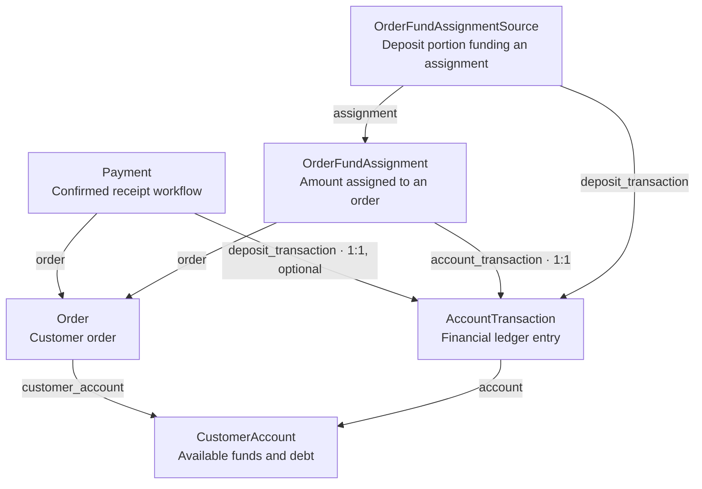
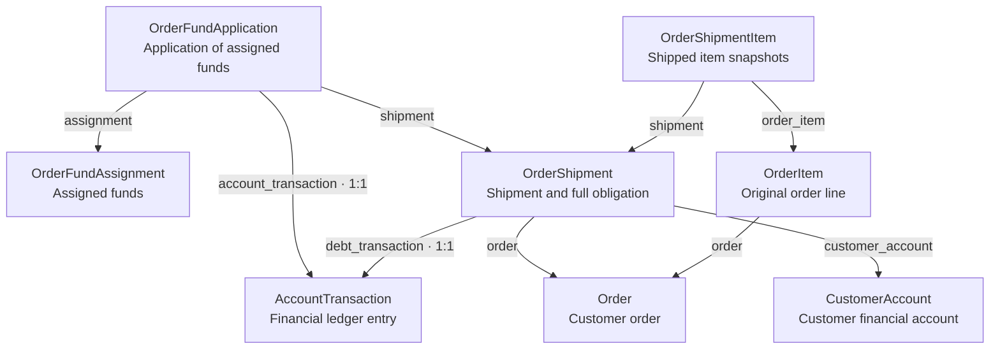

# PHASE 23 — Order Funds and Full-Shipment Settlement

Status: implementation in progress. Receipt-service and invoice foundations,
pre-shipment assignment/release, full shipment with prepayment application,
and post-shipment assignment/removal services are implemented. Full shipment
is connected to existing website/API completion. Staff money-operation
interfaces, customer balance/debt views, receipt correction, manual payouts
and pre-shipment item editing remain open. PHASE 23 is not complete.

## Completed Steps and Current Implementation Boundary

As of 2026-10-17:

- New orders record their owner's matching personal or legal customer
  account. Missing accounts reject checkout without implicit account
  creation. The nullable relation preserves old demonstration orders.
- Website and API checkout save `Order.payment_method` without creating a
  `Payment`, invoice, or ledger operation. Unsupported online checkout and
  on-receipt payment for shipping are rejected.
- `Payment.order` permits several payments per order. The atomic
  `record_manual_order_payment` service creates a confirmed receipt and one
  idempotent account credit through `Payment.deposit_transaction`. Receipt
  retries, conflicting keys, rollback, and staff permissions have tests.
  The staff website/API receipt-registration interface remains to be connected.
- Legacy `reset_payment_to_pending()` rejects a payment linked to a financial
  deposit. This protects the receipt; it does not implement removal of an
  order fund assignment. Legacy records are not credited implicitly.
- Active `FAILED` statuses, actions, controls, and API paths have been removed.
  Historical records and applied migrations are not rewritten.
- `create_invoice_for_order()` issues the full order amount without requiring
  a payment; the current issue workflow requires `PaymentMethod.INVOICE`.
  `Invoice.payment` is optional. `Invoice.order` permits document history,
  with a conditional database uniqueness constraint allowing only one
  `ISSUED` invoice per order.
- Managers and administrators can issue and cancel invoices on the website
  and through the API. Cancellation requires a reason and preserves its
  actor and time. Reissue retains the cancelled document and number and
  creates a new document with a new number. These document actions do not
  create receipts or change account balances or debt.
- Clients can read and download their own invoices by invoice ID without
  a payment; foreign documents are inaccessible. Staff order details show
  the current invoice and a history with cancellation details and PDF links.
  History uses pages of 20 and preserves the list-return context.
- The user reports the complete project test suite passing. Ruff and
  migration-drift checks pass; manual website invoice and history checks
  pass. No mass formatting was applied: intentional multiline layout is
  retained, while `ruff check` remains required.

As of 2026-10-18, the pre-shipment assignment milestone is implemented:

- `FUNDS_ASSIGNMENT` and `record_customer_funds_assignment()` decrease
  available funds without creating debt. `OrderFundAssignment` links the
  order, amount, and unique financial debit; `OrderFundAssignmentSource`
  records each deposit portion used. Database constraints require positive
  amounts and one source row per assignment/deposit pair.
- `assign_order_funds()` lets an active manager or administrator select an
  order and amount. It locks the order and account, validates account owner,
  type and currency, enforces available-funds and remaining-order limits,
  and atomically records the debit, assignment, and sources. Eligible deposit
  portions are selected FIFO by `created_at`, then `pk`; already used portions
  and reversed deposits are excluded. No debt is created before shipment.
- `cancel_order_fund_assignment()` releases one whole selected assignment
  with a required non-blank comment. An additional ledger `REVERSAL` records
  its reason, actor and time; the original assignment and source rows remain.
  Order/source-capacity calculations exclude reversed assignments, so released
  money can be assigned again without changing the receipt or other
  assignments. Identical retries return the original result; conflicting
  keys and a new-key second cancellation are rejected.
- Manager order cancellation and customer cancellation of their own `NEW`
  order release active assignments within the same transaction as status and
  stock changes. Failure rolls back the cancellation. Customer-triggered
  release uses the private internal helper after order permissions are
  checked; customers still cannot manually cancel an individual assignment.
  The financial history retains the initiating user and actor type.
- The user reports 31 assignment-service tests, the existing cancellation
  and manager-workflow modules, and scoped Ruff checks passing. Model tests
  and migration-drift checks also passed during this milestone. The last
  reported full-project run at that milestone was 720 tests on 2026-10-17.
  The subsequent full run and shipment foundation are recorded below.
  Checks are user-run.

As of 2026-10-19, the shipment foundation is implemented:

- Before these new changes, the user ran the full suite: 760 tests passed.
- `FUNDS_APPLICATION` and `record_customer_funds_application()` reduce only
  debt, without debiting available funds again. Tests verify balance deltas,
  rejection above current debt and idempotent retry; the financial-service
  module and scoped Ruff checks pass.
- `OrderShipment` links the order/account, full obligation transaction, amount,
  currency, actor and date. Constraints require a positive amount, one shipment
  per order for this phase and unique use of the debt transaction.
- `OrderShipmentItem` stores its source order line and independent snapshots.
  Constraints require positive quantity and a unique shipment/order-line pair.
  Model-module tests and scoped Ruff checks pass, including snapshot independence.
- `OrderFundApplication` is implemented with positive-amount and unique
  financial-entry constraints. Its three model tests and scoped Ruff checks pass.
  The low-level application primitive does not itself validate order assignments.
  At that checkpoint, completion still only changed status; connection of the
  shipment service was verified on 2026-10-20 below. Model tests alone are not
  proof of full orchestration, historical-edit protection or concurrent safety.

As of 2026-10-20, full shipment is connected and verified:

- `complete_order_shipment()` locks and reloads the order/account, checks staff
  rights, current status, matching account owner/type/currency, non-empty items,
  the saved total including shop-paid delivery, and the active-assignment limit.
- One atomic operation creates `OrderShipment`, item snapshots, the full
  `DEBT_INCREASE`, and `FUNDS_APPLICATION` entries/links for active prepayment,
  then sets `COMPLETED`. Already assigned funds are not debited again.
  Cancelled assignments remain historical and are not applied.
- An authorized retry returns the existing shipment. Failure to create an
  application rolls back shipment, snapshots, obligation and application while
  preserving earlier receipts/assignments.
- Existing `update_order_status_by_manager()`, website and API completion now
  delegate to this service. The website form uses browser confirmation;
  customer completion POSTs receive 403 before order lookup. Other status
  changes retain their existing workflow.
- The user reports 19 shipment-service tests and related workflow, staff-page
  and API modules passing, together with Ruff and `makemigrations --check --dry-run`.
  The full project run passed **796 tests in 709.375 seconds on 2026-10-20**.
- The user applied runtime migrations `finance.0002–0003` and
  `orders.0012–0022`, then manually confirmed that completing an unpaid order
  records the full debt with unchanged available funds in the staff read-only
  account page. Prepayment scenarios are service-tested, not a claim that
  receipt/assignment forms exist. Manual cancellation of the browser dialog
  has not been separately reported.

As of 2026-10-22, post-shipment assignment/removal services are implemented:

- `assign_order_funds()` accepts a completed order only with its matching
  shipment. A new assignment atomically debits available funds, retains FIFO
  deposit sources and applies the amount to the recorded shipment's debt.
  The remaining-order limit still applies even when unrelated account debt
  and available funds are sufficient. The order stays `COMPLETED`.
- Whole selected assignment removal requires a reason. It first reverses the
  debt application, then reverses the assignment debit, restoring the
  corresponding debt and available funds without reversing the real receipt,
  shipment obligation or completed order. Historical rows are retained.
- Sequential tests cover same-key retries, missing shipment, amount limits,
  rollback of assignment/application and rollback between the two cancellation
  reversals. Released funds can be assigned again; reversed history does not
  consume order or deposit capacity.
- The user reports the complete assignment-service module and scoped Ruff
  checks passing on 2026-10-22. No new full-project run or manual website
  assignment/removal test is claimed. These are service-level operations;
  dedicated staff money-action interfaces are not connected yet.

The immediate next milestone is working money pages: connect actual receipt
registration and separate assignment/removal actions, then add customer-facing
balances and the staff shipped-unpaid order list. Receipt correction, actual
cash/bank refunds and pre-shipment item editing remain open.
Existing staff `Finances` account pages already show balances/history read-only.
No shipment correction/reopening or replacement-shipment flow is added.
Independent concurrency coverage for the new financial workflows remains open.

## Order Funds and Shipment Model Map

Model relationships and settlement-service implementation status as of 2026-10-22.
Keep this section synchronized with the main README and local Russian copies.

### Receipts and assignment — implemented

Arrows point from the model holding a reference to the referenced model.
They are database links, not automatic money movements.

- `Payment` records a confirmed receipt in the new manual receipt workflow.
  Its deposit link is optional in the schema for legacy records; legacy
  pending payments are not proof that money was received.
- `OrderFundAssignment` records which amount was explicitly assigned to an
  order. `Payment.order` alone does not assign money or settle that order.
- `OrderFundAssignmentSource` records the deposit portions used. For deposits
  of 40 and 60, an assignment of 70 has two FIFO source rows: 40 and 30.
  Available funds become 30; debt remains zero before shipment.
- `AccountTransaction` is the ledger; `CustomerAccount` stores its current
  available/debt projections. Reversals append history rather than deleting
  assignments or their source records.

### Shipment and application — full-shipment workflow implemented

`OrderShipment`, `OrderShipmentItem` and `OrderFundApplication` exist.
The diagrams show implemented model links. Full-shipment orchestration is
connected to the existing website and API completion actions as of 2026-10-20.

`OrderShipment` retains the order, account, obligation transaction, full amount,
currency, actor and time. Currently a database constraint permits only one
shipment per order; the underlying foreign key leaves room for future partial
shipments. One debt transaction cannot be reused for multiple shipments.

`OrderShipmentItem` retains the original order-line link and independent name,
unit-price, quantity, total and currency snapshots. Quantity must be positive;
an order line cannot repeat within one shipment. Independent snapshot storage
is implemented, and the shipment service automatically copies the order lines.
It validates a non-empty order and the saved total against items and shop-paid
delivery. Snapshot storage alone does not prevent direct historical edits;
broader edit protection and independent concurrent-workflow coverage remain open.

`OrderFundApplication` stores `assignment`, `shipment`, `account_transaction`,
`amount` and `created_at`. Its three model tests and scoped Ruff checks pass;
amount must be positive and the financial entry cannot be reused.
Assignment and shipment use
foreign keys for future partial shipments; the financial entry is one-to-one.
The service must validate matching order, account and currency, active
assignment capacity and the shipment's outstanding obligation.

### Implemented full-shipment settlement example

For a 100 order, a receipt of 100 and an explicit assignment of 60:

| Action | AccountTransaction type | Available | Debt |
|---|---|---:|---:|
| Confirm receipt | `DEPOSIT` | 100 | 0 |
| Assign 60 to the order | `FUNDS_ASSIGNMENT` | 40 | 0 |
| Record full shipment of 100 | `DEBT_INCREASE` | 40 | 100 |
| Apply the assigned 60 | `FUNDS_APPLICATION` | 40 | 40 |

These are four entry types of the same `AccountTransaction` model.
The shipment obligation uses the saved `Order.total_price`: delivery paid to
the shop is included; delivery paid separately to the carrier is excluded.
The last two steps must commit atomically, so the intermediate debt of 100
is not exposed as a committed state. Already assigned money is not deducted
from available funds again. Existing `allocate_customer_funds()` decreases
both balances and is unsuitable for this application step.

`record_customer_funds_application()` is implemented: available delta is zero,
debt delta is minus the positive amount. The order/shipment service must prove
the matching assignment; the low-level finance function alone does not.
`Complete order` now uses `complete_order_shipment()`: the shipment, item
snapshots, full obligation, application of active pre-shipment assignments and
`COMPLETED` status commit atomically. A permitted retry returns the existing
shipment without repeating money movements. Cancelled assignments are excluded;
shipment-level limits prevent using unrelated account debt as capacity.
Post-shipment assignment/removal services are implemented as of 2026-10-22.
For a shipped order of 100 with available funds of 100 and debt of 100,
assigning 60 records `FUNDS_ASSIGNMENT` and `FUNDS_APPLICATION` atomically:
available funds become 40 and debt becomes 40. Whole-assignment removal adds
two `REVERSAL` entries, restoring available funds and debt to 100. The receipt,
shipment and original assignment/application records remain; the order stays
`COMPLETED`. Same-key retries do not repeat balance changes. Dedicated staff
money-action interfaces and independent concurrency tests remain pending.

### Full-shipment confirmation — agreed scope

The website completion form now requests explicit browser confirmation: "Confirm full shipment of order #...? Once confirmed, shipment
cannot be cancelled and order items cannot be edited on the website."
Cancelling the dialog sends no completion request and changes nothing.

PHASE 23 does not implement correction/reopening of a confirmed shipment:
no correction action, shipment-reversal service, corrected-shipment state or
replacement-shipment flow. Keep the existing one-shipment-per-order constraint,
not a conditional "one active shipment" constraint. A real goods return remains
a separate deferred workflow. An accidentally confirmed shipment cannot be
corrected through the standard website workflow in this scope.

The dialog reduces accidental clicks, not deliberate abuse. Server-side
authorization, status/consistency checks, locking, atomicity and idempotent retry
remain mandatory. Assignment removal, receipt correction and actual cash/bank
refunds remain separate agreed money workflows; they do not reopen shipment.

## Goal and Boundaries

Build the smallest reliable link between an order, confirmed customer funds,
full shipment, and any remaining debt. Preserve the immutable account ledger
and atomic balance services from PHASE 22. The result must be demonstrable
with test data before the minimal 1C integration in PHASE 24 and the
internet-facing test pilot in PHASE 25.

Do not replace the existing `Payment` and invoice workflows in one step.
The model may allow later partial shipments, but a partial-shipment action
and UI are out of scope now. Complex mixed-payment checkout, automatic
selection of orders/amounts to pay, goods-return logistics, and a real payment
provider are deferred. Separate office and bank receipts for one order, pre-shipment
fund assignment, and actual manual cash/bank refunds are in scope. Only
provider-driven online withdrawals/refunds are deferred, not all refunds.
This does not introduce a new post-shipment goods-return workflow.

## Clarification of 2026-10-15: Order Payment and Manual Refunds

- Receipt registration and assigning funds as payment for an order are
  separate actions. `Payment` records a receipt; its `PAID` status alone
  does not mean the order has been paid. Derive order settlement from active
  fund assignments, not just the sum of related receipts.
- Fulfillment and settlement remain independent. Removing payment from a
  shipped order does not change `COMPLETED`. Preserve other assignments
  and the remaining amount when one assignment is removed.
- Both managers and administrators may explicitly assign available funds
  before or after shipment. Before shipment, assigning 100 BYN from an
  available 100 leaves freely available funds at zero and debt at zero.
  Those funds cannot simultaneously be assigned to another order.
- Removing an order payment assignment requires a non-blank comment and
  preserves its reason, actor, time, amount, order link, and append-only
  history. Before shipment, it restores the available 100 and leaves debt
  at zero. The actual receipt and its account credit remain unchanged.
- The removal action is the same whether the employee selected the wrong
  order or later discovered a fictitious receipt. Correct the receipt
  separately after undoing dependent assignments; never restore an entire
  old balance snapshot or modify unrelated receipts.
- Within existing cancellation permissions, cancelling an order releases
  assigned funds for reuse and blocks new assignments. It does not prove
  cash was paid out or a bank refund occurred.
- PHASE 23 includes actual manual office-cash and bank-transfer refunds.
  Staff separately confirm the real payout and record its amount, method,
  reason, actor, time, and funding link. The money-out operation, available
  balance decrease, and history are atomic and idempotent. Do not refund
  more than the funds available for that refund or erase the original receipt.
- Remove active `FAILED` paths rather than using failure as a cancellation
  lock. Check the order's cancelled state to reject new payment assignments.
  Preserve historical data and applied migrations; agree any demonstration
  data cleanup separately.
- Shipment accounts for assigned prepayment exactly once. Assigned 100 with
  zero freely available, followed by shipment of 100, must not deduct 100
  again or leave debt on a fully covered order. An obligation arises only
  at shipment; do not create fictitious debt before it.
- Existing `allocate_customer_funds()` decreases both available funds and
  debt and cannot implement pre-shipment assignment. Existing
  `record_customer_refund()` increases available funds and is not a real
  payout. Define correct public financial operations instead of writing
  balance fields directly.

## Confirmed Business Rules

- Clarified on 2026-10-14: choosing a payment method at checkout is not
  evidence that money has been received. Checkout stores that preference on
  the order but creates no `Payment`, account credit, or customer debt.
  An order awaiting payment does not require a pending receipt record or a
  new fulfillment status.
- An actual office payment creates `Payment` only when an authorized
  manager or administrator records and confirms the received amount.
  Verified bank receipts follow the same rule. In one atomic operation,
  create `Payment` directly in `PAID`, record exactly one account-ledger
  credit, and increase the customer's unallocated available balance.
  Either all changes are saved or none are saved; a retry must not create
  another payment or credit. Debt settlement remains a separate staff action.
- Event boundaries are explicit:

  | Event | Create `Payment`? |
  |---|---|
  | Customer places an order and selects office payment | No |
  | Employee issues an `Invoice` | No: it is a document requesting payment |
  | Employee confirms money actually received in the office | Yes |
  | Employee confirms a verified bank receipt | Yes |
  | Employee assigns already received funds to an order before or after shipment | No: this is a separate financial operation |

  For a 100 BYN order, an actual office receipt of 40 BYN creates one
  `Payment` for 40 BYN. A later bank receipt of 60 BYN creates a second
  `Payment` for 60 BYN. Before the money arrives, there are no payments.
- `CustomerAccount` stores the customer's available prepayment and debt;
  `Invoice` is an optional document requesting payment; `Payment` records an
  actual confirmed receipt. An invoice is not required for every order and
  must be issued from the order without requiring a fictitious payment.
- Order placement and invoicing do not create customer debt. Debt arises only
  after shipment is confirmed, for the shipped value.
- In the current business workflow, `Complete order` means full shipment of
  the order. Since 2026-10-20, website/API completion records the shipment,
  full debt and application of existing prepayment atomically and idempotently
  with `COMPLETED`. An unpaid order may still be `COMPLETED`.
- `OrderStatus.SHIPPED` is declared but currently unused. It is reserved for
  a future delivery flow where goods have been dispatched but not received.
  Receiving that delivery must not create debt a second time.
- Use an explicit shipment identity and an order-item quantity foundation
  so later partial shipments can be represented without multiplying order
  statuses. Do not implement partial shipment in this phase.
- One order may receive several separate `Payment` records, each confirmed
  for the amount actually received and credited exactly once. Full shipment
  remains a single action in this phase. For example, a 120.00 order may
  receive 100.00 first and 20.00 later; neither receipt automatically
  allocates funds to its debt.
- Managers and administrators need a separate website view of outstanding
  shipment debt. Its primary operational view must be a
  list of shipped orders with an unpaid amount, showing the customer,
  shipment, and remaining amount for each order. A customer summary may
  complement this view, but must not replace the order-level list. Limit
  and paginate it; do not load settled shipment history by default.
- Initially, actual payment is accepted only in the office or by bank
  transfer. Selecting a payment method, issuing an invoice, or marking an
  order `COMPLETED` does not prove that money was received. A confirmed
  receipt funds the customer account; a separate explicit staff assignment
  pays the order before shipment or settles its debt afterward.
- Manual receipt recording accepts the actual received amount, rather than
  confirming a pending payment automatically prepared for the order total.
  Do not carry over the old pending-payment buttons without reconsidering
  their meaning. Office and bank receipts use one explicit registration
  step that creates a confirmed receipt, not a `PENDING` draft followed by
  a later transition to `PAID`. Legacy pending and mock records must never
  be treated as received money implicitly.
- Confirming receipt credits available customer funds but never assigns
  them to an order automatically. A manager or administrator selects an
  order and explicit amount, bounded by freely available funds and the
  remaining amount to pay. After shipment, respect that order's remaining
  debt as well. Before shipment, assignment must not create debt.
- After staff explicitly select the order and amount, choose its funding
  sources automatically FIFO within that same account and currency. Use
  only unused portions of non-reversed deposits, including usage by other
  orders. Deposits of 40 and 60 funding an assignment of 70 contribute 40
  and 30; the second deposit retains 30. This source selection is not
  automatic order assignment or automatic debt settlement.
- Cancel only a whole selected assignment in this phase. To correct an
  assignment of 70 to 50, cancel the 70 and create a new assignment of 50.
  Do not edit or delete the original assignment or its source rows. A
  separate linked reversal is the cancellation history; no additional
  cancellation table is required for the pre-shipment service.
- Only assignments whose financial debit has no reversal consume the
  remaining order amount or a deposit's unused portion. Historical sources
  remain traceable but must not keep released money unavailable.
- Customers cannot manually assign or remove order funds. Cancelling their
  own `NEW` order may automatically release its active assignments after
  checking ownership, active user, and current order status. This permission
  does not expose the private release helper through a view or API action.
- The customer must see their own personal and legal accounts separately
  in the website account area: currency, unallocated available funds
  (prepayment), order-assigned prepayment, and outstanding debt without
  double counting. This read-only view must not expose
  another customer's balances or create accounts implicitly.
- Bind each order to one specific `CustomerAccount` when the order is created.
  A personal order uses its owner's personal account; a legal-entity order
  uses that owner's legal account. Payment credits, shipment debt, and
  allocations use the account recorded on the order, not a later inference
  from the user's current profile or role. Reject an account owned by
  another user or of the wrong type; never silently reassign an existing
  order to another account.
- At checkout, require the matching account to exist. If it is missing,
  reject order creation with a clear error and leave the cart, stock, and
  order data unchanged. Do not create or repair an account implicitly during
  checkout; fix the missing registration/profile workflow separately.
- PHASE 23 includes manager editing of order items before full shipment,
  including when part of the price has already been received. Confirmed
  `Payment` amounts and account credits represent actual receipts and must
  not be rewritten when the order total changes. No order-item editing is
  allowed after shipment is recorded.
- The manager coordinates a proposed edit with the customer outside the
  website, using an available communication channel, before saving it.
  Saving the edit means the manager takes responsibility for that agreement.
  Do not add an online customer-approval step, pending-change state, or
  approval workflow in PHASE 23. If the customer disagrees, existing
  pre-shipment cancellation rules apply; a new order can then be placed.
- If an invoice was issued, the manager must explicitly cancel it before
  editing the order and issue a new invoice for the revised total afterward.
  Never silently change an issued invoice. Updating order items must also
  keep the order total and stock reservations consistent.
- An additional quantity of a product is a new order item with the current
  validated selling-price snapshot and its own stock reservations, even if
  the product already appears in the order. Existing item prices, quantities,
  and reservations are not silently extended or repriced. Separate price
  batches of the same product remain visible as separate lines.
- Before the manager adds a new order line, recalculate the customer-facing
  selling price from current supplier pricing using the project's pricing
  rules, show the result, and require explicit confirmation. Do not accept
  the new line at a stale catalog price. If the confirmed price changes
  before saving, require confirmation again; existing lines stay unchanged.
- To reduce or remove a quantity, the manager explicitly selects the order
  line/price batch to change. The system must not choose between older and
  newer price batches automatically. Recalculate the total and adjust only
  the selected line's reservations, without repricing the other lines.
- Within the selected line, release stock reservations in the reverse order
  of their original allocation: supplier stock before own warehouse stock.
  For a line reserved as four own-stock units and three supplier units,
  reducing quantity by two releases two supplier units.
- Every manager edit to order items requires a non-blank reason. Record a
  separate append-only order-change history entry for each successful edit:
  who made it, when, why, which item/price batch was added, reduced, or
  removed, the before/after quantity and price snapshot, and the before/after
  order total. Preserve enough detail to explain the reservation change.
  A rejected or rolled-back edit must leave neither a history entry nor a
  partial change to the order total or stock reservations.
- The customer-facing order page shows the updated items, quantities, prices,
  and total, with a visible indication that the order was changed. The
  manager's reason and internal order-change history are available only to
  managers and administrators; never expose them in the customer UI or API.
- An issued invoice records the full order total at issue time.
  Partial receipts are separate Payment records and do not rewrite
  the invoice amount.
- Both managers and administrators may issue and cancel invoices. An issued
  invoice blocks another issue for that order until explicitly cancelled.
  Cancellation preserves the document, number, required reason, actor,
  and time; a replacement has its own number. Keep at most one `ISSUED`
  invoice per order, enforced by the database. Invoice creation and
  cancellation do not record receipt or settle an order.
- A payment may reference the invoice it was made against.
  Office receipts may have no invoice. Existing payment-to-invoice
  references survive invoice cancellation or replacement.

## Business Flow to Model

1. After actual office payment or verified bank receipt, an authorized
   employee enters the received amount and confirms receipt registration.
   In one atomic operation, create `Payment` directly in `PAID` and one
   idempotent account credit, updating the available balance. This increases
   available funds only; no debt is settled yet. It may happen before or
   after shipment. No pre-existing pending payment is required.
2. A manager or administrator explicitly assigns funds to a selected order.
   Before shipment, freely available funds decrease by the assigned amount,
   but debt remains zero. Record the funding source, order, and amount to
   prevent double use. After shipment, assignment settles that order's debt.
   Do not use the existing debt-allocation operation before shipment.
3. The `Complete order` action records the full shipment and its obligation
   in the correct personal or legal customer account, then moves the order
   to `COMPLETED`. Account for already assigned prepayment exactly once,
   without deducting freely available funds again. The uncovered amount
   becomes outstanding debt; without assignments, the full amount is owed.
   Do not automatically select free funds for a new assignment. A retry
   must not duplicate shipment, obligation, or application of prepayment.
   Before this action, a manager may revise the order items and total;
   previously received funds remain unchanged. An issued invoice must be
   cancelled before the edit and replaced afterward.
   Later explicit assignment of available funds settles the remaining
   obligation, bounded by both available funds and that order's debt.
   Partially paid shipped orders remain in the staff unpaid-orders list
   with their remaining amount; fully settled orders leave that list.
4. Removing an order payment assignment releases its funds and recalculates
   settlement using the remaining assignments. After shipment, restore the
   corresponding debt while keeping `COMPLETED`; before shipment, debt
   stays zero. Preserve the real `Payment` and credit. A non-blank comment
   and append-only audit history are required.
5. To correct an incorrectly recorded receipt, first undo every assignment
   depending on that funding, then reverse its account credit. Decide the
   resulting receipt status and correction UI separately: the old return
   to `PENDING` is not automatically appropriate for the new meaning of
   `Payment`. Preserve an auditable trail and roll back a failed correction
   instead of leaving mismatched states.
6. Cancelling an order releases its assigned funds to the available balance,
   blocks new assignments, and does not pay money out automatically.
   Existing restrictions on post-shipment cancellation remain in force.
7. An actual cash payout or bank refund is recorded separately by staff.
   Decrease available funds by its amount and retain the real payout and
   audit history without duplicates. This manual refund is required now;
   provider-driven online withdrawal integration is deferred.

Example without pre-shipment assignment: a confirmed receipt of 100.00 adds
100.00 available funds; shipment of an 80.00 order adds 80.00 debt.
Until a manager allocates funds, both
balances remain visible. Allocating 50.00 leaves 50.00 available and 30.00
debt. These are separate steps even when payment precedes shipment.

For a 120.00 shipped order, two confirmed receipts of 100.00 and 20.00
create two funding records. The manager may allocate 100.00 first, leaving
20.00 order debt, and later allocate the remaining 20.00. The shipment is
still recorded only once.

Pre-shipment assignment example: receipt of 100.00 creates available funds
of 100.00. Assigning all 100.00 to the order leaves freely available funds
at zero and debt at zero. Shipment of 100.00 accounts for that assignment
once and leaves no unpaid debt; it must not deduct another 100.00.

Manual refund example: after assigning the received 100.00 before shipment,
cancelling the order restores available funds to 100.00 but does not pay the
customer. A separately confirmed cash or bank refund of 100.00 then leaves
available funds at zero, preserving both the original receipt and refund.

An order initially totaling 100.00 may receive an unassigned 60.00 before
shipment. If the manager changes its items and total to 120.00 before
shipment, the
confirmed 60.00 stays as available funds and debt stays zero. Full shipment
then creates 120.00 debt; allocating 60.00 leaves 60.00 debt. No old payment
amount or issued invoice is silently rewritten.

If an order already contains seven units of one product at 100.00 each,
reserved as four from own stock and three from a supplier, adding five more
after the selling price changes to 130.00 creates a second order item at
130.00 with its own current-source reservations. The first seven stay at
100.00. The item total is 7 × 100.00 + 5 × 130.00 = 1,350.00 before any
separately charged delivery. Do not assume a changed supplier purchase price
has already refreshed the customer-facing catalog price: validate the price
used for the new line before accepting the edit.

The links explain *why* a balance changed. Account balances alone do not
identify the source of funds or the order being settled.

## Remaining Decisions Before Further Financial Migrations

- Receipt registration already uses a stable `operation_key` and linked
  account credit. What additional evidence of office payment or bank
  receipt should be stored when connecting the staff interface?
- Which final status and permissions are required to correct a receipt after
  safely reversing its credit? Preserve legacy `PENDING` and mock scenarios
  without fictitious credits; do not assume a reset-to-`PENDING` workflow.
- Preserve the implemented prepayment application and post-shipment
  assignment/removal when connecting staff interfaces and receipt correction.
  Available 100 -> assign 100 before shipment -> zero available/zero debt ->
  release back to 100 remains valid. Do not substitute debt allocation or
  receipt totals for assignments or deduct prepayment twice.
- Define actual manual cash/bank refund records, funding links, permitted
  methods, staff permissions, amount, mandatory reason, and retry key.
  Choose a public money-out operation rather than the positive-delta
  `record_customer_refund()` service.
- Before order-item editing, define invoice-item snapshots: a historical
  PDF must not start showing revised order lines. The current PDF reads
  `Order.items`; preserving the document number and amount is insufficient.
- Separately verify concurrent invoice issuance and number allocation.
  The one-issued-invoice constraint does not solve all numbering races.
- Decide how to prepare old demonstration orders without an account for
  future financial scenarios and when to make the relation mandatory in
  the database. They currently retain an empty transitional relation;
  new checkouts reject a missing account without implicit assignment.
- Which item, price, tax, and delivery snapshots form the full shipment
  amount? How will the model permit partial quantities later?
- Use `OrderFundAssignmentSource` to find active assignments dependent on a
  receipt before correcting it. Define the correction's atomic boundary,
  receipt status, and dependency guards, including post-shipment effects.
  Source traceability alone does not implement safe receipt correction.
- Add independent concurrency coverage for assignment, release, and order
  cancellation on a shared account. Account locks and sequential service
  tests are not a substitute for verifying concurrent financial workflows.
- Resolved on 2026-10-19: no shipment correction/reopening in PHASE 23.
  Add explicit confirmation before `Complete order`; preserve one shipment
  per order. Money corrections and future goods returns are distinct workflows.
- Define the smallest append-only order-change history model and how to
  capture the manager's confirmed price and reservation changes. Implement
  reverse reservation release within the selected line, including
  multiple supplier reservations. Never silently rewrite a recorded shipment
  or financial history.
- How should the order-level debt list present multiple shipments or
  payments when these are introduced later? Keep personal and legal account
  balances visibly separate. An optional customer summary must drill down
  to individual unpaid shipped orders.

Record the chosen rules with numerical examples and expected account deltas
before writing migrations.

## Incremental TDD Work Plan

Execution order agreed on 2026-10-20; service progress updated on 2026-10-22.
Full shipment and post-shipment assignment/removal are implemented, not the
whole phase. Each completed step must have a visible acceptance result.
The user edits application code, tests and migrations and runs all checks.
Run only the new test in a small TDD step; run related modules at a behavior
milestone and the full suite at a meaningful checkpoint. Explain targeted
permission regressions. Shared test data belongs in `setUp()`; scenario-specific
preparation stays in its test. Required reasons are validated in services,
not only forms. Do not defer office/bank refunds with online withdrawals.

1. **Full shipment — implemented and verified.** Models, snapshots, obligation
   and prepayment application are connected to existing website/API completion.
   Website confirmation and staff-only POST are in place. The 19 service tests,
   related modules, full 796-test run, Ruff, migration drift and manual unpaid
   shipment check passed. Runtime migrations were applied. Confirm the browser
   cancellation branch manually if it has not yet been checked. Independent
   concurrent-request tests remain open. No shipment undo/reopening is planned.
2. **Assign/remove funds after shipment — service milestone implemented.**
   Explicit assignment debits available funds and applies them to a matching
   shipment within the order's remaining amount. Whole selected removal requires
   a reason, restores funds/debt and preserves `COMPLETED`, receipts and history.
   Same-key retries, limits with unrelated account debt, missing shipment,
   rollback of both flows and reassignment after cancellation are tested.
   The user reports the assignment-service module and scoped Ruff passing on
   2026-10-22. Independent concurrent-request coverage remains open.
3. **Working money pages and balances — next.** Connect staff website/API actions to
   actual receipt registration (a `PAID` Payment and one account credit) and
   separate assignment/removal. Do not reuse legacy pending-payment actions as
   if they implemented this flow. Add customer-only read views for available
   funds, assigned prepayment and debt, separate personal/legal accounts/currency
   without double counting. Add the staff shipped-unpaid order list with customer,
   order, shipment and remaining debt; search/filter, paginate and reconcile it.
   Do not load settled history by default. Existing staff account pages remain
   read-only until the corresponding money actions are explicitly connected.
4. **Receipt correction and real cash/bank refunds.** Agree on corrected receipt
   status and permissions. Undo dependent assignments, reverse the credited
   receipt and retain audit history, with dependency guards, retries, rollback
   and concurrency tests. Actual payout is a separate confirmed outgoing operation
   decreasing available funds, with reason, funding links, authorization and
   excess/retry protection. Assignment removal is not a payout; correcting a
   fictitious receipt is not a real refund. None reopens shipment.
5. **Order-item edits before shipment.** First add invoice-item snapshots so old
   PDFs do not read revised `Order.items`. Require explicit cancellation of an
   issued invoice before editing, then permit replacement. Recalculate totals
   and reservations atomically without changing confirmed receipts/balances.
   New quantities use a new price-batch line even for the same product; display
   and confirm the current selling price before adding. Quantity reduction must
   select the exact line and release that line's reservations in the agreed
   reverse order. Every successful edit needs a staff-only reason and append-only
   history of actor, date, selected line, before/after values and order total,
   in the same transaction. No edits after shipment and no in-app customer
   approval workflow.
6. **Close PHASE 23.** Verify independent concurrent financial flows and invoice
   numbering, reconcile order/shipment/account totals, run the complete regression
   and manual end-to-end scenario, and synchronize documentation. Define the
   narrow order, shipment and money facts for minimal 1C exchange in PHASE 24.
   Only after that move to PHASE 25's controlled internet test pilot, with no
   real sales or live payments.

## Verification Gates

- Before shipment, assigning an available 100 leaves freely available funds
  at zero and debt at zero. Another order cannot use the same money.
  Removing that assignment restores 100 without reversing the real receipt.
- FIFO source portions are bounded by their active use across all orders
  of the same account. Reversed deposits are excluded; reversed assignments
  no longer consume order/deposit capacity, but their history is retained.
- Whole-assignment cancellation is idempotent for the same request and key;
  a different-key second cancellation is rejected without another credit.
  Correcting an amount requires cancellation followed by a new assignment.
- Shipment accounts for assigned prepayment once: a fully covered order has
  neither a second deduction nor an outstanding unpaid debt.
- Fulfillment and settlement remain independent. Removing payment from a
  shipped order restores the corresponding debt but retains `COMPLETED`.
  Other assignments remain intact.
- Managers and administrators may remove an assignment only with a non-blank
  reason and append-only history containing actor, time, amount, and order.
- Order cancellation releases assigned funds for reuse and blocks new
  assignments; it does not automatically refund cash or a bank receipt.
- Customer order cancellation keeps its owner/`NEW` checks and records the
  initiating user in financial history without allowing manual assignment
  cancellation. A release failure rolls back order cancellation and related
  transactional changes for both customer and staff paths.
- Real manual cash/bank refunds are atomic, idempotent money-out operations,
  bounded by refundable available funds, with required reasons and history.
  They are not the positive-delta `record_customer_refund()` operation.
- Active `FAILED` paths are absent; historical records and applied
  migrations remain preserved.
- Checkout through the website or API saves the selected payment preference
  but creates no `Payment`, receipt transaction, or account credit. An order
  awaiting payment does not require a pending receipt record.
- Office-payment selection and actual office receipt registration have
  separate tests: the former creates no payment or invoice; the latter
  creates `Payment` directly in `PAID` for the amount received, exactly one
  ledger credit, and the corresponding available-balance increase.
- Failed receipt registration rolls back the payment, credit, and balance;
  retrying it duplicates none of them. Bank receipts follow the same rule.
- An `Invoice` may be issued before any receipt without a fictitious payment.
  Issuance and allocation do not create `Payment` records.
- Both staff roles may issue and cancel Invoice through the website and API.
  A required cancellation reason, actor, time, and original document number
  survive reissue. A replacement has a distinct identity and number; the
  database permits only one issued invoice per order.
- Client invoice data/PDF access checks order ownership without requiring
  a payment. Staff history is paginated and preserves list-return context.
- Before enabling order-item edits, preserve historical invoice item
  snapshots so re-downloading a cancelled document cannot rewrite its contents.
- No view, admin action, signal, or unrelated service writes balances
  directly.
- Idempotency, uniqueness, non-negative balances, and account ownership
  remain enforced.
- Order, full shipment, source of customer funds, allocation, and remaining
  obligation can be traced without double counting.
- Multiple confirmed payments may fund one order; each receipt is credited
  once, and one full shipment can be settled in separate manual allocations.
- Pre-shipment item edits preserve confirmed receipts and balances, keep
  stock reservations and order totals consistent, and require cancellation
  before replacing an issued invoice. Post-shipment edits are rejected.
- Adding the same product later never extends an old-price order item:
  existing prices stay fixed, while the new quantity uses a validated
  current selling price and separate supplier/stock reservations.
- Reducing quantity changes only the price batch selected by the manager;
  other batches keep their prices and reservations.
- Missing reasons reject order edits without changing data. Each successful
  edit creates exactly one order-change history entry; a failed atomic edit
  creates none and leaves totals and reservations unchanged.
- Customer views and APIs show the revised order but do not expose the
  manager's reason or internal change-history entries.
- Manager edits do not wait for an in-app customer approval. Existing
  cancellation permissions remain in force; this rule does not permit
  cancellation or item edits after shipment.
- Checkout without the matching personal or legal account fails clearly and
  atomically; it does not create an account as a side effect.
- Failed writes roll back ledger and linkage changes; concurrent requests
  cannot allocate the same available funds twice.
- A reversal cannot silently invalidate a dependent allocation.
- Recording an actual receipt credits available funds once but never
  allocates them by itself. Only an explicit staff action settles a selected
  order and amount. Correcting a receipt with dependent allocations is
  rejected until those allocations and its credit are safely reversed in
  order.
- Customers see only their own account balances: freely available funds,
  order-assigned prepayment, and debt without double counting, separately
  for personal and legal accounts.
- Completing an order confirms exactly one full shipment and creates debt
  exactly once. The order may be complete while its debt remains unpaid.
  The staff order-level debt list agrees with the unpaid shipment obligations,
  and a confirmed office or bank-transfer receipt is required to settle them.
- Agreed order, payment, invoice, and PHASE 22 scenarios remain covered by
  green tests. Old expectations of an automatically created pending payment
  at checkout are updated to the newly agreed business rule.
