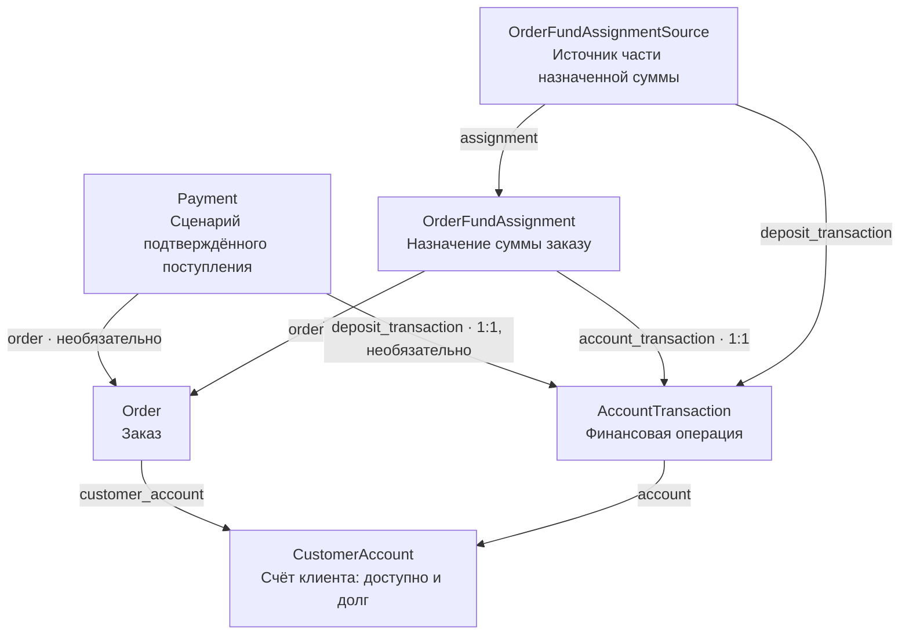
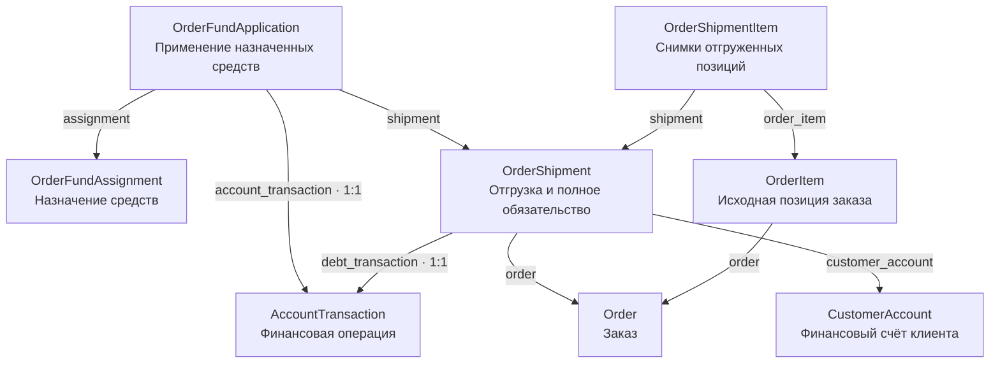

# Фаза 23 — деньги заказа и расчёт после полной отгрузки

**Русский | [English](../phase-23-deposits-and-order-settlement.md)**

Статус: реализация продолжается. Основа поступлений/Invoice, назначение до и
после отгрузки и полная отгрузка с применением предоплаты реализованы.
Отгрузка подключена к завершению на сайте/API; регистрация поступления,
явное назначение и полная отмена назначения подключены к сайту сотрудника
и API. Клиентские балансы доступны в профиле и API только для чтения.
Рабочий список отгруженных неоплаченных заказов реализован с поиском,
пагинацией и сохранением возврата. Исправление поступлений, ручные выплаты
и правки состава заказа до отгрузки ещё впереди.
Фаза 23 не завершена.

Текущая очередь (2026-11-11): [девять шагов и контрольные точки](#current-work-order).

## Выполненные шаги и текущая граница реализации

На 2026-10-13:

- В `Order` добавлено поле `customer_account` с защитой от удаления счёта
  через `PROTECT`; создана миграция `0010_add_customer_account_to_order`.
- При оформлении сервис получает уже существующий личный или юридический
  счёт владельца и сохраняет его в заказе. При отсутствии нужного счёта
  оформление отклоняется без создания заказа и изменения корзины или товара.
- Переходные `null=True` и `blank=True` сохраняют старые демонстрационные
  заказы с пустой связью. Автоматически назначать им счета пока не требуется.
- Подготовка данных в сервисных и API-тестах обновлена с учётом наличия счёта.
  Полный набор из 685 тестов, Ruff и проверка состояния миграций прошли.

На 2026-10-17 дополнительно выполнено:

- `Order.payment_method` сохраняется при оформлении через сайт и API.
  Оформление не создаёт `Payment`, Invoice или финансовую операцию;
  недоступная онлайн-оплата и оплата при получении для доставки отклоняются.
- `Payment.order` допускает несколько поступлений одного заказа. Сервис
  `record_manual_order_payment` атомарно создаёт подтверждённый `Payment`
  и одно идемпотентное пополнение через `Payment.deposit_transaction`.
  Проверены повторы, конфликт ключа, откат и права. Интерфейс регистрации
  фактического поступления через сайт/API ещё предстоит подключить.
- Старый `reset_payment_to_pending()` отклоняет платёж, связанный с
  финансовым пополнением. Это защита поступления, а не реализация снятия
  назначения денег заказу. Последний оставленный красным тест уже исправлен.
- `FAILED` удалён из действующих статусов, действий, форм и API. Старые
  миграции и исторические записи не переписываются.
- Invoice создаётся по заказу независимо от платежей, фиксирует полную
  сумму заказа; текущий сценарий выписки требует `PaymentMethod.INVOICE`.
  `Invoice.payment` необязателен, `Invoice.order` допускает несколько
  документов. Частичное уникальное ограничение БД разрешает только один
  документ в статусе `ISSUED` на заказ.
- Менеджер и администратор могут выписывать и аннулировать Invoice через
  сайт и API. Отмена требует причину, сохраняет автора и время. При
  перевыпуске старый документ и его номер сохраняются, новый получает
  отдельный номер. Выписка и отмена документа не меняют деньги и долг.
- Клиент получает данные и PDF своего Invoice по ID документа без платежа.
  Чужие документы недоступны. Карточка менеджера показывает текущий Invoice
  и историю, включая аннулированные документы, причины, автора, время и PDF.
  История разбита по 20 записей; переходы сохраняют контекст возврата к списку.
- Пользователь подтвердил полный зелёный прогон проекта и ручную проверку
  сайта. Ruff и проверка отсутствия незаписанных изменений моделей пройдены.
  Автоматическое массовое форматирование не выполнялось: осознанные
  многострочные переносы сохраняются, обязательна проверка `ruff check`.

На 2026-10-18 реализован сервисный блок до отгрузки:

- Операция `FUNDS_ASSIGNMENT` и `record_customer_funds_assignment()`
  уменьшают доступные средства без создания долга. `OrderFundAssignment`
  связывает заказ, сумму и единственное финансовое списание;
  `OrderFundAssignmentSource` сохраняет использованные части поступлений.
  Ограничения БД требуют положительные суммы и одну строку источника
  на пару «назначение — поступление».
- В `assign_order_funds()` активный менеджер или администратор выбирает
  заказ и сумму. Сервис блокирует заказ и счёт, проверяет владельца, тип,
  валюту, доступные деньги и неназначенную сумму заказа. Списание, назначение
  и источники сохраняются атомарно. Источники выбираются FIFO по `created_at`,
  затем `pk`; использованные части и отменённые поступления исключаются.
  До отгрузки долг не возникает.
- `cancel_order_fund_assignment()` отменяет выбранное назначение целиком
  с обязательным непустым комментарием. Новая операция `REVERSAL` сохраняет
  причину, инициатора и время; исходное назначение и его источники остаются.
  Отменённые назначения не занимают остаток заказа и поступления, поэтому
  деньги снова доступны для назначения. Поступление и другие назначения
  не изменяются. Повтор того же запроса идемпотентен; конфликт ключа и
  вторая отмена с новым ключом отклоняются.
- Отмена заказа менеджером и отмена клиентом своего заказа в `NEW`
  освобождают действующие назначения в той же транзакции, что изменение
  статуса и товарных остатков. Ошибка откатывает отмену. Клиентский путь
  использует внутреннюю функцию после проверки прав на заказ; напрямую
  отменять отдельное назначение клиент по-прежнему не может. Финансовая
  история сохраняет инициирующего пользователя и тип инициатора.
- Пользователь подтвердил 31 тест сервиса назначений, существующие модули
  отмены/менеджерского workflow и проверки Ruff. В ходе блока также прошли
  тесты моделей и проверка состояния миграций. Последний подтверждённый
  полный прогон на тот момент — 720 тестов от 2026-10-17.
  Последующий полный прогон и основа отгрузки описаны ниже.
  Все проверки выполняет пользователь.

На 2026-10-19 реализована основа отгрузки:

- До этих новых изменений пользователь прогнал весь проект: 760 тестов прошли.
- `FUNDS_APPLICATION` и `record_customer_funds_application()` уменьшают только
  долг, не списывая доступные средства повторно. Проверены изменения балансов,
  запрет суммы сверх долга и идемпотентный повтор; модуль финансовых сервисов
  и адресные проверки Ruff прошли.
- `OrderShipment` связывает заказ/счёт, начисление полного обязательства,
  сумму, валюту, сотрудника и дату. Ограничения требуют положительной суммы,
  одной отгрузки на заказ в текущей фазе и уникального использования операции долга.
- `OrderShipmentItem` хранит исходную позицию заказа и независимые снимки.
  Ограничения требуют положительного количества и уникальной пары
  «отгрузка — позиция заказа». Модули моделей и адресный Ruff прошли,
  в том числе проверка независимости снимков от изменения исходной позиции.
- `OrderFundApplication` создана с ограничениями положительной суммы и
  уникальной финансовой операции. Три теста модели и адресный Ruff прошли.
  Низкоуровневая финансовая операция сама не проверяет назначения заказу.
  На том этапе завершение ещё только меняло статус; подключение сервиса
  отгрузки проверено 2026-10-20 и описано ниже. Тесты моделей сами по себе
  не доказывают готовность общего сервиса, защиты истории и конкурентности.

На 2026-10-20 полная отгрузка подключена и проверена:

- `complete_order_shipment()` блокирует и перечитывает заказ/счёт, проверяет
  права сотрудника, текущий статус, владельца/тип/валюту счёта, непустые
  позиции, сохранённый итог с доставкой магазину и предел активных назначений.
- Одна транзакция создаёт `OrderShipment`, снимки позиций, полное начисление
  `DEBT_INCREASE`, операции и связи `FUNDS_APPLICATION` для действующей
  предоплаты, затем ставит `COMPLETED`. Назначенные деньги не списываются
  повторно; отменённые назначения остаются в истории и не применяются.
- Разрешённый повтор возвращает существующую отгрузку. Ошибка создания
  применения откатывает отгрузку, позиции, обязательство и применение,
  сохраняя ранее полученные и назначенные деньги.
- Существующее завершение в `update_order_status_by_manager()`, на сайте и
  в API делегирует действие этому сервису. Форма использует подтверждение
  браузера; клиентский POST получает 403 до загрузки заказа. Прочие переходы
  сохраняют прежнюю логику.
- Пользователь подтвердил 19 тестов сервиса, связанные модули workflow,
  страниц сотрудника и API, Ruff и `makemigrations --check --dry-run`.
  Полный прогон **796 тестов за 709.375 секунды прошёл 2026-10-20**.
- Пользователь применил к рабочей базе `finance.0002–0003` и
  `orders.0012–0022`, затем руками подтвердил полное начисление долга при
  завершении неоплаченного заказа без изменения доступных средств.
  Предоплата проверена сервисными тестами — это не означает наличия форм
  поступления/назначения. Отмена диалога браузера отдельно пользователем
  ещё не подтверждена.

На 2026-10-22 сервисы назначения и снятия оплаты после отгрузки реализованы:

- `assign_order_funds()` принимает завершённый заказ только при наличии
  соответствующей отгрузки. Назначение атомарно уменьшает доступные средства,
  сохраняет FIFO-источники поступления и погашает долг зарегистрированной
  отгрузки. Предел оставшейся суммы заказа действует даже при достаточном
  общем долге и доступном балансе. Заказ остаётся в `COMPLETED`.
- Полная отмена выбранного назначения требует причину: сначала сторнируется
  применение к долгу, затем списание назначения. Соответствующий долг и
  доступные деньги восстанавливаются без отмены реального поступления,
  обязательства отгрузки или завершённого заказа. Исторические записи сохраняются.
- Последовательные тесты проверяют повторы с тем же ключом, отсутствие
  отгрузки, предел суммы, откат назначения/применения и откат между двумя
  обратными операциями отмены. Освобождённые деньги можно назначить заново;
  отменённая история не занимает сумму заказа и источников поступления.
- Пользователь подтвердил весь модуль сервисов назначения и адресный Ruff
  2026-10-22. Нового полного прогона и ручной проверки назначения/снятия на
  сайте не заявляем. Это сервисный уровень; отдельные интерфейсы денежных
  действий сотрудников на том сервисном рубеже ещё не были подключены.

Также 2026-10-22 реализован этап регистрации поступления через сайт сотрудника:

- Менеджер и администратор открывают `Register receipt` из блока Payments
  заказа. Сервис требует финансовый счёт; у старых заказов без счёта ссылка скрыта.
- `ManualPaymentReceiptForm` принимает положительную десятичную сумму,
  поступление в офисе либо безналом и необязательный комментарий. Скрытый ключ
  создаётся на GET и сохраняется при POST/ошибке; онлайн-оплаты в форме нет.
- `ManagerRecordReceiptView` вызывает `record_manual_order_payment()`:
  атомарно создаются один ручной Payment в `PAID` и одно пополнение счёта.
  Назначение, погашение долга, изменение статуса заказа и Invoice не создаются.
- Проверены поступление в офисе менеджером, безнал администратором без Invoice,
  запрет клиентского POST, повтор ключа, конфликт данных, ошибка суммы с
  сохранением формы/ключа и контекст фильтра/страницы списка при переходе
  из заказа, отправке формы и возврате Back to order.
- Пользователь подтвердил модули страниц поступления, сервиса поступления и
  существующих страниц заказа сотрудника, а также адресный Ruff. Переход
  на форму, возврат и регистрация поступления проверены руками: доступный
  баланс увеличивается на внесённую сумму, долг не уменьшается.
  Нового полного прогона не заявляем.

На 2026-10-25 назначение и отмена назначения подключены к сайту сотрудника:

- Менеджер и администратор назначают доступные деньги со страницы заказа.
  GET только показывает форму; POST вызывает существующий атомарный сервис.
  До отгрузки уменьшается только доступный баланс, после неё также погашается
  соответствующий долг. Новое поступление или Invoice не создаются.
- На странице заказа есть история назначений с пагинацией, суммой, сотрудником,
  комментарием и сведениями об отмене. У действующей записи есть ссылка отмены;
  отменённая запись сохраняется в истории без такой ссылки.
- Для отмены обязательны непустая причина и скрытый ключ операции. До отгрузки
  восстанавливаются доступные деньги; после неё — деньги и соответствующий
  долг без отмены поступления, отгрузки или COMPLETED. Повтор с тем же ключом
  не возвращает деньги повторно; новая попытка с другим ключом показывает
  ошибку формы и не переписывает первоначальную причину отмены.
- Проверены действия менеджера, отмена администратором после отгрузки, запрет
  клиентского POST, обязательная причина, повторы и сохранение ключа при ошибке.
  Ссылки, Back to order и скрытое поле next сохраняют фильтр и страницу
  исходного списка заказов при GET и POST. История назначений имеет пагинацию.
- Пользователь подтвердил модули страниц назначения/отмены, селекторов назначений,
  существующих страниц заказа сотрудника и Ruff. Все 13 тестов страницы отмены
  прошли. Вручную проверены изменения балансов/долга при назначении, отмена
  и сохранение фильтра списка, включая COMPLETED. Затем пользователь выполнил
  полный прогон: **846 тестов прошли за 1025.223 секунды 2026-10-25**.
  git diff --check не выявил ошибок пробелов, только предупреждения LF/CRLF.
  Отдельные конкурентные проверки ещё впереди.

На 2026-10-28 API регистрации поступления, назначения и полной отмены
назначения реализованы через существующие атомарные сервисы. Новые 25 тестов
(8 поступления, 9 назначения, 8 отмены) проверяют права, суммы, обязательные
ключи/причины, повторы, конфликтующие ключи и сохранность истории.
Назначение/отмена после отгрузки проверены с сохранением COMPLETED.
Пользователь подтвердил связанные API-модули заказов/платежей, сервисные
модули поступлений/назначений, Ruff и git diff --check. Модели не менялись,
новых миграций нет. После API пользователь выполнил полный прогон:
**871 тест прошёл за 1076.950 секунды 2026-10-28**. Ruff по всему проекту
прошёл; git diff --check не выявил ошибок пробелов, только предупреждения
LF/CRLF. Отдельные конкурентные проверки ещё впереди.

- Поступление принимает положительную сумму, ручной способ офиса/безнала
  и ключ вызывающей стороны; комментарий необязателен. Возвращается Payment
  с кодом 201, включая безопасные повторы. Invoice, назначение и погашение
  долга автоматически не создаются. Ручное подтверждение онлайн-оплаты запрещено.
- Назначение принимает положительную сумму, ключ и необязательный комментарий.
  Ответ 201 содержит id, order_id и десятичную сумму строкой, включая повторы.
  Проверяются доступные деньги и остаток заказа; до отгрузки долг не создаётся.
- Отмена принимает ключ и обязательную непустую причину. Отменяется выбранное
  назначение целиком, ответ 200 содержит assignment_id/reversal_id.
  Повтор возвращает ту же обратную операцию. Вторая отмена с новым ключом
  отклоняется без повторного зачисления или перезаписи первоначальной причины.
- POST аутентифицированного клиента получает 403. Ошибки полей и бизнес-правил
  возвращают 400 без частичных финансовых изменений. После отгрузки отменяются
  применение и назначение; поступление, отгрузка, исходные строки источников/
  применения и COMPLETED сохраняются.
- Это проверки API/сервисов, а не новая ручная проверка API или отдельная
  проверка конкурентных запросов. Модели и миграции не менялись.

На 2026-11-04 клиентские балансы доступны на сайте в `accounts:profile`.
Селектор `get_customer_account_balances()` получает собственные счета
пользователя и показатели одним SQL-запросом. Назначенная предоплата —
сумма действующих назначений минус действующие применения при отгрузке;
сторнированные записи исключаются, использованные деньги повторно не учитываются.
Личный и юридический счета показаны отдельно, каждый со своей валютой,
доступными средствами, предоплатой и долгом. Отсутствие счёта даёт пустой
результат и сообщение, без автоматического создания счёта.
Имя пользователя в навбаре открывает профиль, кнопка Edit profile —
редактирование. Вьюшка использует вошедшего пользователя, а не `user_id`
из адреса. Пользователь подтвердил 10 тестов селектора, 6 тестов профиля,
существующий модуль frontend-авторизации, адресный Ruff и git diff --check;
также подтвердил ручную проверку сайта. Новых моделей и миграций нет.
API клиентских балансов реализован и проверен на 2026-11-04:
`GET /api/accounts/balances/` (`api-account-balances`) возвращает 200 и список
собственных счетов через тот же селектор, что сайт. Каждый элемент содержит
`id`, `account_type`, `status`, `currency`, `available_balance`,
`assigned_prepayment` и `debt_balance`; денежные суммы — строки с двумя знаками.
Счета возвращаются без пагинации: сейчас у пользователя максимум личный и
юридический счёт. Для пользователя без счетов возвращается пустой список,
без создания счёта. Запрос без входа получает 401; чужой `user_id` не меняет
выборку. POST/PUT/PATCH/DELETE получают 405, балансы и журнал сохраняются.
Восемь новых тестов проверяют нули, авторизацию, принадлежность, предоплату,
состояние после отгрузки, отсутствие счетов, разделение типов и запрет записи.
Пользователь подтвердил весь модуль `api.accounts.tests`, адресный Ruff и
git diff --check. Модели и миграции не менялись.

Полный прогон после клиентских балансов прошёл **2026-11-04: 895 тестов
за 787.610 секунды**. git diff --check не выявил ошибок пробелов, только
предупреждения LF/CRLF.

На 2026-11-09 рабочий список отгруженных неоплаченных заказов реализован:
`/shop/orders/manage/unpaid/` (`orders:manager_unpaid_order_list`).
Менеджер и администратор сразу видят непогашенные отгрузки по 20 записей;
клиент получает 403, гость направляется на вход. Долг каждой строки равен
сумме отгрузки минус действующие применения средств; отменённые применения
и назначения исключаются. Полностью погашенные отгрузки уходят из списка,
после отмены назначения возвращаются. Старый `COMPLETED` без `OrderShipment`
не создаёт долг и не включается автоматически.
Поиск по фрагменту email и точному номеру заказа сужает выборку; условия
совмещаются, ошибочный номер даёт пустой результат. Пагинация и переход
в заказ/Back сохраняют условия и страницу. После погашения последнего долга
на странице возврат показывает последнюю доступную страницу с тем же поиском.
Отдельный пункт навбара `Unpaid shipments` ведёт к ежедневному контролю.
Меню `Finances` объединяет `Payments`, `Customer accounts` и
`Transaction journal`; дублирующая кнопка журнала со страницы счетов убрана.
Пользователь подтвердил 11 тестов селектора и 14 тестов страницы, связанные
модули, адресный Ruff, git diff --check и ручную проверку сайта.
Селектор с нужными связанными данными выполняется одним SQL-запросом.
Модели и миграции не менялись; данные страниц доступны только для чтения.
Полный прогон после списка долгов прошёл **2026-11-09: 920 тестов
за 941.617 секунды**.

Список долгов закоммичен и опубликован: `c7abdc5`.
Далее: улучшаем финансовую сводку заказа и свёрнутые истории по плану ниже,
затем завершаем проверки/интерфейсы исправления поступлений и реальные возвраты.
Исправление поступлений, реальные возвраты наличных/безнала и правки состава
до отгрузки ещё впереди. Страницы `Finances` показывают балансы/историю только
для чтения. Исправление/повторное открытие отгрузки не добавляем.
Отдельные конкурентные проверки новых денежных сценариев ещё предстоят.

## Схема моделей денег заказа и отгрузки

Связи моделей и состояние реализации сайта/API/сервисов расчёта на 2026-11-10.
Раздел синхронизируется с основным README и опубликованной английской версией.

### Поступление и назначение средств — реализовано

Стрелка направлена от модели с полем-ссылкой к связанной модели.
Это связи в базе данных, а не автоматическое движение денег.

- `Payment` фиксирует подтверждённое поступление в новом ручном сценарии.
  Связь с пополнением необязательна в схеме для старых записей; старый
  ожидающий платёж не доказывает, что деньги действительно получены.
- `Payment.order` теперь необязателен. Ограничение базы
  `payment_requires_order_or_deposit` требует хотя бы одну заполненную связь:
  `order` или `deposit_transaction`; обе одновременно разрешены.
  У поступления без заказа счёт определяется через `deposit_transaction.account`.
  Сервис `record_manual_account_payment` реализован; модуль проверен 18 тестами,
  включая запрет Invoice без заказа.
  Страницы и API чтения/регистрации поддерживают поступления без заказа.
  Карточка счёта сотрудника показывает три баланса и Register receipt.
  Возврат сохраняет счёт и поиск; транзакции изначально свёрнуты,
  а при переходе между страницами истории по 20 записей остаются раскрыты.
- `OrderFundAssignment` сохраняет явно назначенную заказу сумму.
  Само поле `Payment.order` не назначает деньги и не погашает заказ.
- `OrderFundAssignmentSource` хранит использованные части поступлений.
  Для поступлений 40 и 60 назначение 70 имеет два FIFO-источника: 40 и 30.
  Доступно остаётся 30; до отгрузки долг не возникает.
- `AccountTransaction` — журнал финансовых операций, а `CustomerAccount`
  хранит текущие проекции доступных средств и долга. Сторнирование дополняет
  историю, а не удаляет назначения и их источники.

### Отгрузка и применение средств — полная отгрузка подключена

Модели `OrderShipment`, `OrderShipmentItem` и `OrderFundApplication` созданы.
На схемах показаны существующие связи. На 2026-10-20 общий сервис полной
отгрузки подключён к существующему завершению заказа через сайт и API.

`OrderShipment` сохраняет заказ, счёт, операцию начисления обязательства,
полную сумму, валюту, сотрудника и дату. Пока ограничение БД разрешает
одну отгрузку на заказ; сам `ForeignKey` оставляет основу для будущих
частичных отгрузок. Одно начисление долга нельзя связать с двумя отгрузками.

`OrderShipmentItem` сохраняет связь с исходной позицией заказа и отдельные
снимки названия, цены, количества, суммы и валюты. Количество положительное;
одна позиция заказа не повторяется внутри отгрузки. Независимое хранение
снимков реализовано; сервис отгрузки автоматически копирует позиции заказа.
Он проверяет непустой состав и сохранённый итог с учётом товаров и доставки
магазину. Само хранение снимков не запрещает прямые правки истории;
общая защита правок и отдельные конкурентные проверки ещё предстоят.

`OrderFundApplication` хранит `assignment`, `shipment`, `account_transaction`,
`amount` и `created_at`. Три теста модели и адресный Ruff прошли;
сумма положительная, финансовую операцию нельзя использовать повторно.
Назначение и отгрузка связаны
через `ForeignKey` с учётом будущих частичных отгрузок; финансовая операция —
через `OneToOneField`. Сервис должен проверять совпадение заказа, счёта и
валюты, доступную действующую сумму назначения и непогашенное обязательство
конкретной отгрузки.

### Реализованный пример расчёта при полной отгрузке

Для заказа на 100, поступления 100 и явного назначения 60:

| Действие | Тип AccountTransaction | Доступно | Долг |
|---|---|---:|---:|
| Подтвердили поступление | `DEPOSIT` | 100 | 0 |
| Назначили заказу 60 | `FUNDS_ASSIGNMENT` | 40 | 0 |
| Записали полную отгрузку на 100 | `DEBT_INCREASE` | 40 | 100 |
| Применили назначенные 60 | `FUNDS_APPLICATION` | 40 | 40 |

Это четыре типа записей одной модели `AccountTransaction`.
Полное обязательство берётся из сохранённого `Order.total_price`: доставка,
оплачиваемая магазину, включена; отдельная оплата перевозчику исключена.
Последние два шага должны фиксироваться атомарно, без отдельного сохранённого
промежуточного долга 100. Уже назначенные средства не списываются с доступного
баланса повторно. Старый `allocate_customer_funds()` уменьшает оба баланса
и не подходит для этого применения предоплаты.

`record_customer_funds_application()` реализован: изменение доступного
баланса равно нулю, изменение долга — минус положительная сумма.
Соответствие назначению должен обеспечивать сервис заказа/отгрузки;
низкоуровневая финансовая функция сама его не проверяет.
`Complete order` теперь вызывает `complete_order_shipment()`: отгрузка,
снимки позиций, полное обязательство, применение действующих назначений
до отгрузки и статус `COMPLETED` сохраняются атомарно. Разрешённый повтор
возвращает существующую отгрузку без повторного изменения денег. Отменённые
назначения исключаются; предел отгрузки не позволяет использовать чужие
обязательства счёта как дополнительную ёмкость погашения.
Сервисы назначения и снятия оплаты после отгрузки реализованы на 2026-10-22.
Для отгруженного заказа на 100 при доступных средствах 100 и долге 100
назначение 60 атомарно создаёт `FUNDS_ASSIGNMENT` и `FUNDS_APPLICATION`:
доступно становится 40, долг — 40. Полная отмена назначения добавляет две
операции `REVERSAL`, восстанавливая доступные средства и долг до 100.
Поступление, отгрузка и исходные записи назначения/применения сохраняются;
заказ остаётся в `COMPLETED`. Повторы с тем же ключом не меняют балансы повторно.
Регистрация поступления и отдельные формы назначения/отмены подключены
к сайту и API. Отдельные конкурентные тесты ещё впереди.

### Подтверждение полной отгрузки — согласованные границы

Форма завершения на сайте теперь запрашивает явное подтверждение браузера: «Подтверждаете полную отгрузку заказа №…? После подтверждения
отменить отгрузку или изменить состав заказа на сайте нельзя».
При отмене диалога запрос завершения не отправляется и ничего не меняется.

В фазе 23 не реализуем исправление/повторное открытие подтверждённой отгрузки:
не добавляем действие исправления, сервис сторнирования отгрузки, состояние
исправленной записи или повторную отгрузку взамен ошибочной. Сохраняем
существующее ограничение «одна отгрузка на заказ», а не условие «одна
действующая». Реальный возврат товара — отдельный отложенный сценарий.
Ошибочно подтверждённую отгрузку штатно исправить на сайте в этих границах нельзя.

Диалог снижает риск случайного нажатия, но не защищает от намеренного обхода.
Серверные проверки прав, статуса и согласованности, блокировки, атомарность
и идемпотентность обязательны. Снятие назначения, исправление поступления
и фактические ручные возвраты остаются отдельными согласованными денежными
сценариями; они не открывают отгрузку повторно.

## Цель и границы

Сделать минимальную надёжную связь между заказом, подтверждёнными деньгами
клиента, полной отгрузкой и оставшимся долгом. Сохраняются неизменяемый
журнал операций и атомарные сервисы фазы 22. Результат нужно показать на
тестовых данных до минимальной интеграции с 1С в фазе 24 и тестового
развёртывания в интернете в фазе 25.

Не заменяем существующие `Payment` и счета-фактуры одним большим изменением.
Структура может предусматривать будущие частичные отгрузки, но действие
и интерфейс частичной отгрузки сейчас не делаем. Сложные сценарии смешанной
оплаты при оформлении, автоматический выбор оплачиваемых заказов и сумм,
возвраты товаров и настоящий платёжный провайдер откладываются. Отдельные поступления
в офисе и по безналу, назначение предоплаты заказу и ручной фактический
возврат наличных/безнала входят в фазу 23. Откладываются вывод и возврат
через онлайн-провайдера, а не все денежные возвраты. Это не включает новый
процесс возврата уже выданного товара.

## Уточнения от 2026-10-15 — оплата заказа и ручной возврат

- Поступление на счёт и назначение денег оплатой заказа — разные действия.
  `Payment` в текущем сервисе представляет поступление. Сам по себе его
  статус `PAID` не означает, что заказ оплачен. Общее состояние расчётов
  определяется отдельными активными назначениями средств, а не только
  суммой связанных поступлений.
- Состояние выполнения заказа и состояние расчётов независимы. Заказ может
  быть новым, в работе или выданным и одновременно ожидать оплаты либо быть
  оплаченным. После снятия оплаты выданный заказ остаётся `COMPLETED`.
  При частичной оплате сохраняются полученная/назначенная сумма и остаток;
  другие оплаты нельзя потерять при отмене одной операции.
- Менеджер и администратор отдельно назначают доступные средства заказу,
  в том числе до отгрузки. Пример: доступно 100 BYN; назначено новому заказу
  100; свободный остаток стал 0, долг до отгрузки остался 0, заказ оплачен.
  Эти 100 нельзя одновременно использовать для другого заказа.
- Снятие оплаты заказа — одно действие с обязательным непустым комментарием.
  Его могут выполнять менеджер и администратор. Назначенные средства снова
  доступны: в примере остаток возвращается к 100 BYN, долг до отгрузки 0,
  заказ ожидает оплаты. Реальное поступление и его пополнение не отменяются.
  Сохраняются причина, автор, время, сумма, связь с заказом и история изменения.
- Не требуется выбирать разные действия снятия оплаты в зависимости от
  того, ошиблись ли заказом или позже обнаружили ошибку заведения денег.
  Само ошибочное поступление исправляется отдельно по ранее согласованным
  правилам, после снятия зависимых назначений. Нельзя откатывать весь баланс
  к старому снимку или менять чужие поступления.
- Отмена заказа в пределах действующих правил отмены освобождает назначенные
  ему средства на доступный баланс. Клиент может использовать их снова.
  Отмена заказа не подтверждает фактическую выдачу наличных или перевод.
- В фазе 23 обязательны ручные фактические возвраты оплат, полученных в офисе
  и по безналу. Авторизованный сотрудник подтверждает уже состоявшуюся выдачу
  или банковский возврат. Сумма, способ, причина, автор, время и связь с
  исходными деньгами сохраняются в истории; исходящая операция и уменьшение
  доступного баланса выполняются атомарно и без дублей. Нельзя вернуть больше
  доступных для возврата средств. Исходное реальное поступление не исчезает.
- Онлайн-вывод/возврат через стороннего провайдера остаётся будущей
  возможностью. Это не откладывает ручной возврат наличных и безнала.
- `FAILED` удаляется из действующих статусов, действий, форм, фильтров и API
  вместе с соответствующими ожиданиями тестов. Отменённый заказ блокирует
  новое назначение оплаты проверкой своего состояния. Применённые миграции
  и исторические записи не переписываются; обработку демонстрационных
  записей с прежним статусом согласуем отдельно.
- При отгрузке назначенная предоплата учитывается один раз: при назначенных
  100 и свободном остатке 0 отгрузка на 100 не должна повторно списывать
  доступные 100 или оставлять непогашенный долг полностью оплаченного заказа.
  Обязательство возникает только при отгрузке. Схему учёта назначения и его
  зачёта нужно определить до кода; нельзя создавать фиктивный долг заранее.
- Существующий `allocate_customer_funds()` уменьшает и доступные средства,
  и долг. Он не реализует назначение предоплаты до отгрузки. Существующий
  `record_customer_refund()` увеличивает доступные средства и не является
  фактической выдачей денег клиенту. Для новых действий нужны корректные
  публичные финансовые операции, а не прямые изменения полей баланса.

Эти уточнения согласованы в roadmap, подробном английском плане фазы 23
и этой локальной копии. Английский план обновлён с отдельного разрешения
пользователя 2026-10-17.

## Когда создаётся Payment — согласованная формулировка (2026-10-14)

Фактическая оплата в офисе создаёт `Payment`. Выбор способа оплаты ещё не означает получение денег.

Разделяем события:

| Событие | Создаётся `Payment`? |
|---|---|
| Клиент оформил заказ и выбрал оплату в офисе | Нет |
| Менеджер выставил `Invoice` | Нет — это документ для оплаты |
| Клиент передал деньги в офисе, менеджер подтвердил получение | Да |
| Деньги поступили по безналу, менеджер подтвердил поступление | Да |
| Менеджер распределил уже полученные деньги на долг заказа | Нет — это отдельная финансовая операция |

При подтверждении поступления мы должны одновременно:

- создать `Payment` сразу со статусом `PAID` и **фактически полученной суммой**;
- записать поступление в финансовый журнал;
- увеличить нераспределённый баланс клиента.

Это одна атомарная операция: либо сохраняется всё, либо ничего. Погашение долга остаётся отдельным действием менеджера.

Например, заказ на 100 BYN. Клиент заплатил в офисе 40 BYN — создаём первый `Payment` на 40. Позже перечислил 60 BYN — второй на 60. До поступления этих денег никаких платежей не создаём.

Поэтому нужны два разных теста: выбор оплаты в офисе не создаёт платёж; подтверждение полученных денег — создаёт.

## Согласованные бизнес-правила

- Уточнение от 2026-10-14: оформление сохраняет выбранный клиентом способ
  оплаты в заказе, но не создаёт `Payment`, не пополняет баланс и не создаёт
  долг. «Заказ ожидает оплаты» описывает его финансовое состояние, а не
  существование записи ожидающего поступления. Новые статусы отгрузки для
  этого не добавляем.
- Для офиса и безнала `Payment` создаётся только при явном подтверждении
  сотрудником фактического поступления, сразу со статусом `PAID` и на реально
  поступившую сумму. Запись поступления и одно идемпотентное пополнение
  соответствующего финансового счёта создаются атомарно. Черновик `PENDING`
  при оформлении заказа не создаём; распределение остаётся отдельным действием.
- `Invoice` выставляется на основании заказа независимо от существования
  `Payment`. Нельзя требовать фиктивный платёж для создания счёта на оплату.
- Создание заказа и выставление счёта не создают долг клиента. Долг
  возникает только после подтверждённой отгрузки на её стоимость.
- По текущему бизнес-правилу `Complete order` означает полную отгрузку
  заказа. С 2026-10-20 завершение на сайте/API атомарно и идемпотентно
  сохраняет отгрузку, полный долг, применение предоплаты и переход в
  `COMPLETED`. Неоплаченный заказ при этом может быть `COMPLETED`.
- `OrderStatus.SHIPPED` объявлен, но пока не используется. Это запас
  для будущей доставки: товар отправлен, но клиент ещё не получил его.
  Получение товара не должно начислять долг повторно.
- Нужны отдельная запись отгрузки и основа для учёта количества позиций,
  чтобы позже добавить частичные отгрузки без множества статусов заказа.
  В этой фазе частичную отгрузку не реализуем.
- По одному заказу допустимы несколько отдельных записей `Payment`:
  каждая подтверждается на фактически поступившую сумму и зачисляется
  только один раз. Отгрузка в этой фазе всё равно только целиком. Например,
  по заказу на 120,00 сначала поступает 100,00, потом 20,00; ни одна из
  оплат не распределяется на долг автоматически.
- Выставленный `Invoice` фиксирует полную сумму заказа на момент
  выставления, независимо от сумм отдельных поступлений. По заказу и счёту
  на 1000,00 клиент может заплатить 400,00 и затем 600,00: это две записи
  `Payment`, а сумма выставленного счёта остаётся 1000,00. Подтверждение
  частичной оплаты не переоценивает счёт.
- `Payment` может иметь необязательную связь с конкретным `Invoice`,
  по которому поступили деньги. Оплата в офисе может существовать без
  счёта-фактуры. Указанный документ должен принадлежать тому же заказу.
  Отмена или замена счёта не перепривязывает уже поступившие платежи:
  историческая ссылка на исходный документ сохраняется.
- Менеджеру и администратору нужен отдельный раздел долгов по
  отгрузкам. Основной рабочий вид — список
  отгруженных заказов с неоплаченной суммой: для каждого видны клиент,
  отгрузка и остаток долга. Сводка по клиентам может дополнять, но не
  заменять список заказов. Список ограничиваем и разбиваем на страницы;
  погашенную историю не загружаем по умолчанию.
- На первоначальном этапе оплата происходит только в офисе или по безналу.
  Выбранный способ оплаты, выставленный счёт и статус заказа `COMPLETED`
  сами по себе не подтверждают поступление денег. Подтверждённое поступление
  пополняет счёт клиента, а отдельное ручное распределение сотрудника
  погашает долг по отгрузке.
- Ручное подтверждение поступления должно принимать фактическую сумму,
  а не подтверждать автоматически подготовленную полную сумму заказа.
  Старые действия над ожидающим платежом не переносятся в новый сценарий
  без проверки смысла. Для офиса и безнала нужен один шаг регистрации
  подтверждённого поступления, а не создание ожидания с последующим
  переводом `PENDING` в `PAID`.
- Подтверждение поступления пополняет доступные средства клиента, но не
  оплачивает заказ и не погашает ни один долг автоматически. Менеджер или
  администратор отдельно назначает средства заказу до либо после отгрузки.
  Назначение до отгрузки исключает средства из свободного остатка без
  начисления долга; после отгрузки учитывается конкретный остаток обязательства.
  Связь с источником средств и заказом исключает повторное использование денег.
- После явного выбора сотрудником заказа и суммы источники подбираются
  автоматически FIFO только внутри того же счёта и валюты. Используются
  неотменённые поступления за вычетом частей, занятых действующими
  назначениями любых заказов. Из поступлений 40 и 60 назначение 70 берёт
  40 и 30; во втором поступлении остаётся 30. Подбор источников не означает
  автоматического назначения денег заказу или погашения долга.
- В этой фазе отменяем выбранное назначение только целиком. Чтобы исправить
  назначение 70 на 50, отменяем 70 и создаём новое назначение 50. Исходное
  назначение и источники не редактируем и не удаляем. История отмены до
  отгрузки — отдельная связанная операция `REVERSAL`; дополнительная таблица
  отмен для текущего сервиса не требуется.
- Остаток заказа и использованную часть поступления занимают только
  назначения без отменяющей операции у их финансового списания. Исторические
  источники сохраняются, но не продолжают блокировать освобождённые деньги.
- Клиент не может вручную назначать или снимать деньги заказа. Отмена
  собственного нового заказа может автоматически освободить назначения после
  проверки владельца, активности пользователя и актуального статуса `NEW`.
  Это не разрешает вызывать внутреннюю функцию освобождения из views/API.
- В личном кабинете клиент видит только свои личный и юридический счета
  раздельно: валюту, нераспределённую предоплату (доступные средства) и
  непогашенный долг. Эта страница только читает данные и не создаёт счета.
- При создании каждый заказ привязываем к одному конкретному
  `CustomerAccount`. Личный заказ — к личному счёту владельца, заказ
  юрлица — к его юридическому счёту. Зачисление денег, долг отгрузки и
  распределение используют счёт, записанный в заказе, а не выводят его
  позднее из текущего профиля или роли пользователя. Чужой счёт либо
  счёт неверного типа отклоняем; существующий заказ незаметно к другому
  счёту не перепривязываем.
- При оформлении заказа требуем уже существующий счёт нужного типа. Если
  его нет, отклоняем оформление с понятной ошибкой, оставляя корзину,
  остатки товара и данные заказов без изменений. Не создаём и не исправляем
  счёт скрыто при оформлении; причину отсутствия устраняем отдельно в
  сценарии регистрации или юридического профиля.
- В фазе 23 менеджер сможет менять состав заказа до полной отгрузки,
  даже если часть суммы уже поступила. Подтверждённые `Payment` и зачисления
  отражают реальные деньги: при изменении итога заказа их не переписываем.
  После записи отгрузки менять позиции нельзя.
- До сохранения правки менеджер согласовывает её с клиентом доступным
  способом вне сайта. Сохранение означает ответственность менеджера за
  такое согласование. В фазе 23 не добавляем подтверждение клиентом на сайте,
  состояние «ожидает согласия» и отдельный процесс согласования. Если
  договориться не удалось, действуют существующие правила отмены до
  отгрузки; после этого клиент может оформить новый заказ.
- Если счёт уже выставлен, менеджер сначала явно отменяет его, затем
  меняет заказ и выставляет новый счёт на изменённую сумму. Выставленный
  счёт незаметно не правим. Изменение позиций должно согласованно
  пересчитывать итог заказа и резервы товаров.
- Дополнительное количество того же товара добавляется отдельной строкой
  заказа с проверенной актуальной продажной ценой на момент добавления
  и собственными резервами. Старые позиции, цены и резервы незаметно не
  увеличиваем и не переоцениваем. Партии одного товара с разной ценой
  остаются видны разными строками.
- Перед добавлением новой строки пересчитываем продажную цену по актуальным
  данным поставщиков и правилам ценообразования проекта, показываем её
  менеджеру и требуем явного подтверждения. По устаревшей цене каталога
  строку не добавляем. Если цена изменилась до сохранения, нужно повторное
  подтверждение; старые строки не переоцениваем.
- При уменьшении или удалении количества менеджер явно выбирает строку
  заказа и ценовую партию. Система не выбирает между старой и новой ценой
  сама. Пересчитываем итог и изменяем резервы только выбранной строки,
  не переоценивая остальные.
- Внутри выбранной строки освобождаем резервы в обратном порядке их
  создания: сначала товар поставщика, затем собственный склад. Если
  зарезервированы четыре штуки со своего склада и три у поставщика,
  уменьшение на две освобождает две штуки у поставщика.
- Для каждого изменения позиций менеджер обязан указать непустую причину.
  Каждое успешное изменение записываем отдельно в неизменяемую историю
  правок заказа: кто, когда и зачем изменил заказ, какую строку/ценовую
  партию добавил, уменьшил или удалил, количество и цену-снимок до и после,
  сумму заказа до и после. Сохраняем достаточно данных, чтобы объяснить
  изменение резервов. Ошибка или откат не оставляют ни записи истории, ни
  частичного изменения суммы или резервов.
- Клиентская страница заказа показывает обновлённые позиции, количество,
  цены и итог с понятной отметкой об изменении заказа. Причина менеджера и
  внутренняя история правок доступны только менеджеру и администратору;
  клиентский интерфейс и API их не раскрывают.

## Какой процесс нужно представить данными

1. После оплаты в офисе или проверки поступления по безналу уполномоченный
   сотрудник вводит фактически поступившую сумму и подтверждает регистрацию.
   В одной атомарной операции создаются `Payment` в `PAID` и одно
   идемпотентное пополнение счёта. Растут только доступные средства, долг
   пока не погашается. Это может произойти до или после отгрузки.
2. Менеджер или администратор явно назначает средства оплатой выбранного
   заказа. До отгрузки свободный остаток уменьшается на назначенную сумму,
   но долг не создаётся. Сохраняются источник, заказ и сумма, исключающие
   двойное использование. После отгрузки назначение учитывает долг именно
   этого заказа. Прежний сервис погашения долга нельзя применять до отгрузки.
3. Действие `Complete order` записывает полную отгрузку и обязательство на её
   стоимость по нужному личному или юридическому счёту, затем переводит
   заказ в `COMPLETED`. Уже назначенные деньги учитываются один раз без
   повторного списания свободного остатка; непокрытая часть остаётся долгом.
   Если назначения нет, долг возникает целиком. Система не выбирает свободные
   деньги для нового назначения автоматически. Повтор не дублирует отгрузку,
   обязательство или учёт предоплаты.
   До этого действия менеджер может изменить состав и итог заказа;
   полученные деньги остаются без изменений. Выставленный счёт нужно
   отменить до правки и после неё оформить новый.
   Позднейшее явное назначение доступных средств погашает конкретный
   оставшийся долг, не превышая доступных средств и остатка обязательства.
   Частично оплаченный отгруженный заказ остаётся в рабочем списке
   с остатком долга, полностью оплаченный из списка исчезает.
4. Снятие оплаты заказа освобождает относящиеся к нему назначенные средства
   и пересчитывает состояние расчётов с учётом оставшихся оплат. Если товар
   уже выдан, соответствующий долг восстанавливается, а `COMPLETED` остаётся.
   До отгрузки долг по-прежнему нулевой. Реальный `Payment` и пополнение
   остаются. Непустой комментарий и неизменяемая история обязательны.
5. Чтобы исправить ошибочно зарегистрированное поступление, сначала
   отменяем все распределения, зависящие от этих денег, затем сторнируем
   пополнение счёта. Конечный статус записи и действие интерфейса согласуем
   отдельно: прежний возврат в `PENDING` не считается автоматически
   подходящим новому смыслу `Payment`. Историю сохраняем; неудачное
   исправление откатываем, не оставляя расхождений.
6. Отмена заказа освобождает назначенные средства в доступный баланс,
   запрещает новую оплату этого заказа и не означает автоматическую выплату.
   Действующие ограничения отмены после отгрузки не расширяются этим правилом.
7. При реальной выдаче наличных или банковском возврате сотрудник отдельно
   фиксирует исходящую операцию. Доступные средства уменьшаются на её сумму,
   реальный возврат и история сохраняются без дублей. Такой ручной возврат
   обязателен в фазе 23; интеграция онлайн-вывода откладывается.

Пример без назначения предоплаты: подтверждённая оплата 100,00 увеличивает
доступные средства на 100,00; отгрузка заказа на 80,00 увеличивает долг на
80,00. До решения
менеджера видны обе суммы. Распределение 50,00 оставляет 50,00 доступных
средств и 30,00 долга. Это отдельные шаги, даже если оплата была раньше.

При отгрузке заказа на 120,00 два подтверждённых поступления 100,00 и
20,00 создают два источника денег. Менеджер может сначала распределить
100,00, оставив долг 20,00, а затем распределить оставшиеся 20,00.
Отгрузка при этом записывается только один раз.

Пример ручного возврата до отгрузки: клиент внёс 100,00, сотрудник назначил
их заказу, свободный остаток стал 0, долг 0. После отмены заказа свободный
остаток снова 100,00 — это ещё не выплата клиенту. После подтверждённой
выдачи наличных или банковского возврата 100,00 остаток становится 0,
долг остаётся 0. Поступление, снятие оплаты и фактическая выплата сохраняются
раздельно в истории. Состояние заказа остаётся `CANCELLED`.

Если по заказу на 100,00 до отгрузки поступило 60,00 без назначения заказу,
а менеджер изменил состав и итог стал 120,00, подтверждённые 60,00 остаются доступными
средствами, долг пока равен нулю. Полная отгрузка создаёт долг 120,00;
распределение 60,00 оставляет долг 60,00. Старую сумму платежа и ранее
выставленный счёт незаметно не переписываем.

Если в заказе уже семь штук одного товара по 100,00 (четыре в резерве
собственного склада и три у поставщика), а после роста продажной цены до
130,00 добавляют ещё пять, создаётся вторая строка по 130,00 со своими
резервами из актуального источника. Первые семь остаются по 100,00.
Итог товаров: 7 × 100,00 + 5 × 130,00 = 1 350,00, без отдельно
оплачиваемой доставки. Изменение закупочной цены поставщика само по себе
не гарантирует, что продажная цена каталога уже обновилась: перед
добавлением новой строки её нужно проверить.

Связи объясняют, *почему* изменился баланс. Одних итоговых балансов
недостаточно, чтобы узнать источник денег или погашенный заказ.

## Согласованное исправление поступления — 2026-11-09

Базовый сервис `cancel_manual_order_payment()` реализован. Пользователь подтвердил
все 12 тестов исправления, существующий модуль регистрации поступлений, адресный
Ruff и diff. Проверены отмена без назначений, история/причина, запрет при действующем
назначении и отмена после его снятия, повторы ключа, конфликты причины/нового ключа,
запрет клиенту/неактивному менеджеру, отмена безнала администратором и полный откат
при ошибке создания истории. Действие сайта/API ещё не подключено. До завершения
сценария остаются проверки соответствия платежа связанному пополнению, сохранения
состояния после отгрузки и отдельные конкурентные проверки. На том сервисном рубеже
последний полный прогон составлял 920 тестов; более поздний рубеж пополнения счёта
записан в текущем плане ниже.

- Менеджер или администратор может отменить ошибочно зарегистрированное ручное
  поступление с обязательной причиной. Исходный `Payment` переходит из `PAID`
  в `CANCELLED`, а не возвращается в `PENDING`.
- Связанное пополнение сторнируется дополнительной финансовой операцией.
  Сохраняются исходное поступление и пополнение, связь со сторно, причина,
  сотрудник и время. Сторнирование и изменение статуса/истории Payment атомарны.
- Первый случай: зарегистрированы 100 BYN, которых фактически не получали;
  назначений нет. Отмена уменьшает доступный баланс на 100 BYN, не меняя долг
  и состояние выполнения заказа. Это исправление, а не выдача наличных или
  банковский возврат клиенту.
- Зависимые назначения нужно безопасно снять до отмены исходного поступления.
  Их история и необходимое восстановление долга сохраняются; отгрузка не открывается.
- Последующее действительное поступление — новый `Payment`. Старые сценарии
  `PENDING`/mock сохраняются без фиктивных зачислений; запрет
  `reset_payment_to_pending()` для платежей со связанным пополнением остаётся.
- Реализуем сервис по TDD, начиная с отмены поступления без назначений.
  Историю, обязательную причину, права, зависимости, повторы, откат и конкурентность
  проверяем следующими шагами.

## Финансовый UI заказа — в работе

По просьбе пользователя выполняем это улучшение перед продолжением исправления поступлений.

На 2026-11-10 доступный остаток счёта показан в списке долгов. На странице заказа
есть денежная сводка, отдельные строки действий и свёрнутые истории поступлений,
назначений и Invoice. После исправления шаблона пользователь подтвердил модули
страниц заказа/Invoice и ручную проверку UI. Пагинация поступлений (20 + 1 запись),
независимость сводки от страницы и ссылки с сохранением возврата/других историй
прошли отдельные тесты. Сохранение раскрытой истории при смене страницы ещё
не завершено. Нового полного прогона и результата Ruff по UI не заявляем.

- В `Unpaid shipped orders` показываем зелёным доступные для назначения средства
  финансового счёта клиента. При поступлении 150 и назначении 90 остаётся 60,
  если других движений по счёту нет. Это общий остаток счёта, а не разность
  поступлений и назначений одного заказа. Используем уже загруженный счёт;
  историю транзакций для каждой строки не запрашиваем.
- На служебной странице заказа перед кнопками регистрации и назначения размещаем
  краткую сводку: действующие подтверждённые поступления, зарегистрированные через
  этот заказ, действующие назначения ему, долг по его отгрузке и доступные средства
  счёта клиента. Долг заказа возникает после отгрузки, а не при оформлении.
  Отменённые/сторнированные записи исключаем; итоги не зависят от страницы истории.
- Истории поступлений и назначений изначально свёрнуты, при раскрытии виден список.
  Сохраняем пагинацию назначений и добавляем её поступлениям — по 20 записей.
  Одно сворачивание разметки не ограничивает выборку из базы.
- Сохраняем фильтры исходного списка, Back и независимые параметры страниц историй.
  При переходе по пагинации соответствующая история должна оставаться открытой.
- Реализуем по учебному процессу/TDD: код приложения и шаблонов меняет пользователь,
  он же запускает тесты и Ruff.
- Ближайший приоритет — согласованное ниже пополнение счёта без заказа. Затем
  завершаем раскрытие историй при смене страниц и возвращаемся к согласованности
  платежа/пополнения, проверкам после отгрузки, отменам, выплатам и конкурентности.
  Денежные правила поступления, назначения и отгрузки этим улучшением не меняются.

## Поступление на счёт без заказа — согласовано 2026-11-10

Это обязательный сценарий фазы 23. Модельный шаг завершён:
`Payment.order` допускает пустое значение, а ограничение
`payment_requires_order_or_deposit` запрещает запись без заказа и пополнения
одновременно. Созданы миграции `0012_allow_payment_without_order` и
`0013_require_payment_order_or_deposit`. Пользователь подтвердил **14 тестов**
моделей платежа/истории за **11.231 секунды**, адресный Ruff и
`makemigrations --check --dry-run`. Проверены оба новых случая и сохранение
существующих платежей с заказом. Проверку миграций в базе сайта пользователь
подтвердил 2026-11-11; полный контрольный прогон — 1002 теста за 1215.051 секунды.
Затем контрольный прогон подтвердил **86 связанных тестов за 138.452 секунды**:
сервисы поступления/исправления, финансовая сводка, страницы заказа/долгов
и Invoice. Ruff модулей orders/payments прошёл; git diff --check сообщил только
предупреждения LF/CRLF. Это адресный рубеж, а не новый полный прогон.
Сервис `record_manual_account_payment` реализован: офис/безнал без заказа,
один PAID Payment и одно пополнение, без автоназначения или долга.
Пользователь подтвердил 17 тестов нового модуля и адресный Ruff; при рефакторинге
прошли связанные модули поступления/исправления. Общие проверки и создание Payment
вынесены во внутренние помощники.
Страницы платежей и поиск по email поддерживают поступления без заказа.
Клиентский API определяет владельца через счёт и возвращает `customer_account_id`;
служебный API также возвращает email клиента. Реализован
`POST /api/payments/manage/accounts/{account_id}/receipts/`: права сотрудников,
офис/безнал, повторы/конфликты ключа, 400/401/403/404 без лишних зачислений.
Предел суммы входного сериализатора согласован с Payment: 12 цифр, 2 после запятой.
Пользователь подтвердил связанные API-модули, Ruff и git diff --check.
Оба хвоста совместимости закрыты: старые валидаторы Invoice явно отклоняют
поступление без заказа, а отдельный тест чтения своей истории восстановлен.
Пользователь подтвердил сервисный модуль из 18 тестов, клиентский из 7 тестов,
связанные модули Invoice и Ruff.
На 2026-11-11 карточка счёта и форма поступления без заказа реализованы.
Сводка переиспользует расчёт свободных средств, назначенной предоплаты и долга.
Возврат из формы, после POST и к исходному поиску сохраняет параметры;
внешний адрес возврата отклоняется. Повтор одной формы не удваивает зачисление,
клиент получает 403 на GET/POST, предел суммы формы совпадает с Payment (12, 2).
Транзакции свёрнуты по умолчанию; пагинация по 20 находится внутри блока,
при переходах история остаётся раскрытой. Пользователь подтвердил 8 тестов
формы, 7 тестов карточки, связанные проверки и Ruff, вручную — сводку,
сохранение поиска и раскрытие истории. Затем пользователь подтвердил полный
прогон **1002 тестов за 1215.051 секунды 2026-11-11**, Ruff всего проекта
и git diff --check (только предупреждения LF/CRLF).
У клиента может быть финансовый счёт и предоплата до появления первого заказа.

- Из `Finances → Customer accounts → счёт` менеджер или администратор регистрирует
  фактически полученные наличные в офисе либо безнал. Атомарно создаются один
  подтверждённый `Payment` и связанное пополнение; растут только свободные средства.
  Заказ, Invoice, назначение и долг автоматически не создаются.
- Связь поступления с заказом делаем необязательной. Счёт определяется через
  `Payment.deposit_transaction.account`. У Payment без заказа обязательно
  должно быть связанное финансовое поступление; запись одновременно без заказа
  и пополнения запрещаем. Существующие поступления через заказ сохраняются.
- Необязательный заказ — контекст регистрации. Последующее назначение использует
  существующие связи назначения/источника/применения. Поступление без заказа
  не перепривязываем одному заказу после распределения и не подменяем им оплату.
- До подключения кнопки адаптируем списки/карточки Payment, клиентскую проверку
  владельца, ответы API и старые пути Invoice к `order=None`. Поступления
  остаются видны владельцу/сотрудникам; действия, требующие заказа, проверяют его
  наличие. Сохраняем старые pending/mock-сценарии без фиктивных пополнений,
  проверки суммы/валюты/счёта, права, повторы и атомарную историю/исправления.
- Карточка счёта показывает сведения о клиенте и три согласованные суммы:
  **свободные средства**, **предоплата, назначенная до отгрузки**, **долг по
  отгруженным заказам**. Используем эти ясные подписи вместо неоднозначного
  «дебета». Назначенная предоплата исключает применённые/сторнированные суммы.
- Рядом со сводкой размещаем `Register receipt`. Транзакции изначально свёрнуты;
  существующая пагинация по 20 записей находится внутри раскрываемого блока.
  Сохраняем фильтры поиска счетов, возврат, независимые страницы историй и раскрытие
  при пагинации. Личный и юридический счета одного клиента остаются раздельными.
- Начинаем по TDD с поступления, связанного со счётом клиента без единого заказа.
  Затем запрещаем Payment без заказа и пополнения, реализуем сервис и адаптируем
  его потребителей перед формой сотрудника. Код, миграции и проверки выполняет
  пользователь; документацию ведёт ассистент.
- После этого возвращаемся к незавершённому раскрытию историй заказа при пагинации,
  согласованности поступления/пополнения и проверкам после отгрузки, интерфейсам
  отмены, реальным ручным выплатам и конкурентности. Схемы в обоих README и планах
  обновляем по факту изменения модели.

## Оставшиеся решения перед следующими финансовыми миграциями

- Сервис поступления уже использует устойчивый `operation_key` и связь
  с пополнением. Какие дополнительные подтверждающие сведения об оплате
  в офисе или по безналу нужно сохранять при подключении интерфейса?
- Сохранить реализованное применение предоплаты и назначение/снятие оплаты
  после отгрузки при подключении интерфейсов и исправления поступлений.
  Проверенный сценарий до отгрузки остаётся прежним: доступно 100 →
  назначено 100 → свободно 0/долг 0 → освобождено обратно до 100.
  Не подменять назначения суммой `Payment` или погашением долга и не
  списывать предоплату повторно.
- Определить запись ручного фактического возврата наличных/безнала, источник
  возвращаемых средств, допустимые способы возврата, права подтверждения,
  сумму, обязательную причину и ключ повтора. Выбрать публичную исходящую
  финансовую операцию вместо `record_customer_refund()` с положительной дельтой.
- Перед изменением состава заказа определить снимки строк Invoice:
  исторический PDF не должен начать показывать изменённые позиции заказа.
  Текущий PDF использует `Order.items`; одного сохранения номера и суммы
  документа для неизменности его содержимого недостаточно.
- Отдельно проверить конкурентную выписку, включая выделение номера Invoice.
  Ограничение одного `ISSUED` на заказ не решает все гонки генерации номера.
- Как подготовить старые демонстрационные заказы без счёта для будущих
  финансовых сценариев и когда сделать связь обязательной в БД? На текущем
  переходном этапе они сохраняются с пустой связью; новое оформление без
  нужного счёта отклоняется.
- Какие снимки позиций, цен, налогов и доставки образуют сумму полной
  отгрузки? Как модель позже позволит хранить частичные количества?
- Использовать `OrderFundAssignmentSource` для поиска действующих назначений,
  зависящих от исправляемого поступления. Определить атомарную границу,
  статус поступления и защиту зависимостей с учётом последствий после
  отгрузки. Наличие связей ещё не реализует безопасное исправление поступлений.
- Добавить отдельные конкурентные тесты назначения, освобождения и отмены
  заказов с общим счётом. Блокировки и последовательные сервисные тесты
  не заменяют проверку одновременных финансовых действий.
- Решено 2026-10-19: исправление/повторное открытие отгрузки в фазе 23 не
  реализуем. Перед `Complete order` добавляем явное подтверждение; сохраняем
  одну отгрузку на заказ. Денежные исправления и будущий возврат товара —
  отдельные сценарии.
- Определить минимальную модель неизменяемой истории правок заказа и способ
  сохранить подтверждённую менеджером цену и изменения резервов. Реализовать
  освобождение резервов внутри выбранной строки в обратном порядке, в том
  числе при нескольких поставщиках. Нельзя незаметно переписывать
  записанную отгрузку или финансовую историю.
- Как показывать в списке заказов несколько отгрузок или оплат, если они
  появятся позже? Балансы личного и юридического счетов должны оставаться
  раздельными. Дополнительная сводка по клиентам должна вести к отдельным
  неоплаченным отгруженным заказам.

Перед следующими миграциями финансовых связей запишем выбранные правила
на числовых примерах с ожидаемыми изменениями балансов.

## Последовательность маленьких TDD-шагов

Единый рабочий порядок на 2026-11-11. Этот список задаёт ближайшую очередь;
предыдущие датированные разделы сохраняют историю решений и проверок.
Фаза 23 продолжается. Полная отгрузка, начисление долга, назначение/снятие
средств, клиентские балансы и список неоплаченных отгрузок уже работают.
У исправления поступления готовы базовый сервис и 12 проверенных тестов;
интерфейсы и дополнительные проверки ещё впереди. UI заказа улучшен,
но раскрытие историй после пагинации ещё не завершено.

Текущая точка: модельный рубеж зафиксирован пользователем. Сервис
`record_manual_account_payment` реализован и проверен 17 тестами и Ruff;
связанные модули поступления/исправления прошли при рефакторинге.
Пункт 3 завершён: страницы/API и POST поступления на счёт прошли связанные проверки.
Отказ Invoice без заказа проверен, тест чтения своей истории восстановлен;
модули сервиса (18 тестов), клиентского API (7 тестов), Invoice и Ruff прошли.
Пункт 4 реализован: сводка счёта, форма поступления без заказа, безопасный возврат
с сохранением поиска, проверка суммы, повторы, запрет клиенту и свёрнутая история
с пагинацией. Пользователь подтвердил адресные тесты, связанные модули, Ruff,
ручные проверки навигации/истории и проверку миграций базы сайта.
Далее — контрольная точка пополнения счёта, затем пункт 5 (оставшийся UI историй заказа).
Полная проверка контрольной точки пройдена 2026-11-11: 1002 теста за 1215.051 секунды,
Ruff всего проекта и git diff --check (только предупреждения LF/CRLF).

1. **Защита модели Payment — выполнена.** Запрещена запись одновременно без
   заказа и связанного пополнения; существующие платежи с заказами сохранены.
   Оба новых случая и связанные модели проверены: 14 тестов, Ruff и проверка
   миграций прошли. Схемы и документация актуальны. Первая контрольная точка:
   логические промежуточные коммиты накопленной проверенной работы.
2. **Приём денег прямо на финансовый счёт — сервис реализован.** Клиент может
   не иметь заказов; офис/безнал атомарно создают PAID Payment и одно пополнение.
   Растёт только доступный остаток. Проверены роли, раздельные счета, сумма/валюта,
   ключи/повторы, конфликты и откат: 17 тестов и Ruff прошли. Общие проверки
   и создание Payment переиспользуются поступлением через заказ.
3. **Адаптация страниц/API — выполнена.** Списки/карточки, поиск по email,
   идентификация счёта, клиентские права и POST регистрации прошли проверки.
   Ссылки на заказ и карточка Invoice условные. Старые валидаторы отклоняют
   Invoice без заказа; отдельный тест собственной истории восстановлен.
   Связанные сервисные/API/Invoice-модули и Ruff прошли.
4. **Карточка счёта сотрудника — реализована; далее контрольная точка.**
   Сведения о клиенте, три баланса, Register receipt и форма офиса/безнала
   подключены. Back и успешный POST сохраняют счёт, поиск и фильтры.
   Внешний возврат отклоняется, повтор формы не удваивает зачисление,
   клиенту запрещены GET/POST, точность суммы совпадает с Payment.
   Транзакции свёрнуты по умолчанию, пагинация по 20 внутри блока;
   при смене страницы история остаётся раскрытой. Адресные/связанные тесты,
   Ruff, ручные проверки UI и проверка миграций сайта подтверждены.
   Перед коммитом проверить фактическое поступление клиенту без заказов:
   растут только свободные средства. Обновить документацию и сделать отдельный
   промежуточный коммит законченного пополнения счёта.
5. **Закрыть оставшиеся пункты финансового UI заказа.** Поступления, назначения
   и Invoice сохраняют раскрытие при своей пагинации; параметры других историй
   и исходного списка не теряются. Проверить Back к платежу с другой страницы
   и ограничение выборки. Закрепить границы сводки: другие заказы общего счёта,
   отменённые записи, отсутствие отгрузки и полностью погашенный заказ.
6. **Завершить исправление ошибочных поступлений.** Дополнить существующий
   сервис проверками согласованности платежа/пополнения и случаями без заказа
   и после отгрузки. Сначала отдельно снимаются зависимые назначения;
   затем сторнируется поступление с обязательной причиной, историей и статусом
   CANCELLED. Подключить сайт/API. Поступление и отгрузка не подменяют друг друга:
   подтверждённая отгрузка остаётся COMPLETED, необходимый долг восстанавливается.
7. **Реализовать фактические возвраты наличных и безнала.** Перед кодом уточнить
   источники/способы и подтверждение выплаты. Это отдельная расходная операция
   из свободных средств с причиной, автором, историей, пределами и защитой повторов.
   Снятие назначения или исправление фиктивного поступления не означает выдачу
   денег. Возвраты офиса/безнала обязательны в фазе 23; онлайн-вывод отложен.
8. **Снимки Invoice и правки состава до отгрузки.** Сначала сделать строки
   выписанного Invoice независимыми от текущих Order.items. Затем разрешить
   согласованные правки менеджера/администратора с причиной и историей.
   Новое количество по новой цене — отдельная строка; итоги/резервы меняются
   атомарно. Действующий Invoice сначала аннулируется, после отгрузки правки
   запрещены. Частичные отгрузки и исправление подтверждённой отгрузки не добавляем.
9. **Закрыть фазу 23.** Отдельно проверить конкурентные денежные действия
   и нумерацию Invoice, сверить суммы/источники, выполнить полный прогон
   и ручной сквозной сценарий. Синхронизировать README, схемы и планы на обоих
   языках, подготовить минимальный контракт обмена с 1С. Только затем фаза 24
   (минимальная интеграция с 1С) и фаза 25 (контролируемый интернет-пилот
   без реальных продаж и живых внешних платежей).

На каждом маленьком шаге: сценарий и пояснение → один новый тест → результат
пользователя → реализация → повтор теста. После законченного поведения —
связанные модули; полный набор на существенном рубеже. Общие данные в setUp,
особенности денег в тесте/небольшом помощнике. Код, миграции, тесты и Ruff
меняет/запускает пользователь; ассистент объясняет, читает и ведёт документацию.
Новый запрос можно включить в очередь, но перед переключением фиксируем
текущую точку и оставшийся шаг.

## Условия проверки

- Назначение предоплаты до отгрузки: из доступных 100 назначение 100 оставляет
  свободный остаток 0 и долг 0. Другой заказ не может использовать те же деньги.
  Снятие оплаты возвращает свободные 100, не отменяя реальное поступление.
- FIFO учитывает занятость поступлений действующими назначениями всех
  заказов этого счёта. Отменённые поступления исключены; отменённые назначения
  больше не занимают остаток заказа и источника, сохраняя историю.
- Полная отмена назначения идемпотентна для того же запроса и ключа;
  вторая отмена с другим ключом отклоняется без нового зачисления.
  Для исправления суммы отменяют назначение и создают новое.
- Назначенная предоплата учитывается при отгрузке ровно один раз; полностью
  покрытый заказ не получает повторное списание и непогашенный долг.
- Состояние выполнения независимо от расчётов. Снятие оплаты выданного заказа
  восстанавливает соответствующий долг без отката `COMPLETED`.
- Менеджер и администратор снимают оплату заказа только с непустым комментарием;
  причина, автор, время и история сохраняются. Пустая причина не меняет данные.
- Отмена заказа освобождает назначенные деньги для повторного использования,
  блокирует новое назначение и не создаёт фактическую выплату автоматически.
- Клиентская отмена сохраняет проверки владельца и `NEW`, записывает
  инициатора в финансовую историю и не разрешает ручную отмену назначения.
  Ошибка освобождения откатывает отмену заказа и связанные транзакционные
  изменения как в клиентском, так и в менеджерском пути.
- Ручной возврат наличных/безнала уменьшает доступные средства только при
  отдельном подтверждении реальной выплаты, создаёт исходящую операцию и
  историю; повтор и превышение доступной суммы не допускаются, ошибка
  откатывает записи и баланс. Онлайн-вывод не является условием этого сценария.
- Активные `FAILED`-сценарии отсутствуют; история и применённые миграции сохранены.
- Выбор оплаты в офисе и регистрация фактического поступления покрываются
  разными тестами: выбор не создаёт платёж или счёт на оплату; регистрация
  создаёт `Payment` сразу в `PAID` на полученную сумму, ровно одну операцию
  пополнения журнала и соответствующее увеличение доступного баланса.
- Выставление `Invoice` и распределение уже полученных средств не создают
  новые записи `Payment`. Счёт на оплату нужен не каждому заказу.
- Оформление через сайт или API сохраняет условия оплаты, но не создаёт
  `Payment`, запись поступления или пополнение баланса. Признак ожидания
  оплаты заказа не требует записи ожидающего платежа.
- Ручная регистрация подтверждённого поступления создаёт `Payment` сразу
  в `PAID` на фактически полученную сумму и ровно одно пополнение. Ошибка
  откатывает обе записи; повтор запроса не дублирует ни одну из них.
- Выставить `Invoice` можно до первого поступления, без фиктивного платежа.
- Ни вьюшка, ни админка, ни сигнал, ни сторонний сервис не меняют
  балансы напрямую.
- Сохраняются идемпотентность, уникальность, неотрицательные остатки
  и принадлежность операций правильному счёту.
- Заказ, полная отгрузка, источник денег, погашение и остаток долга
  прослеживаются без двойного учёта.
- По одному заказу допустимы несколько подтверждённых оплат; каждая
  зачисляется один раз, а долг после одной полной отгрузки можно погашать
  несколькими ручными распределениями.
- Счёт содержит полный итог заказа на момент выставления. Частичные
  поступления сохраняются отдельными платежами без изменения суммы счёта.
- Платёж может не иметь счёта-фактуры; при указанном документе проверяется
  принадлежность тому же заказу. Отмена и замена документа сохраняют
  исходные ссылки уже поступивших платежей.
- Изменение состава до отгрузки не меняет подтверждённые поступления и
  балансы, сохраняет корректность резервов и суммы заказа и требует
  отмены выставленного счёта перед выпуском нового. После отгрузки
  изменение состава запрещено.
- Дополнение того же товара не увеличивает старую позицию по прежней цене:
  старые цены сохраняются, а новое количество получает проверенную
  актуальную продажную цену и собственные резервы по источникам товара.
- При уменьшении меняется только выбранная менеджером ценовая партия;
  цены и резервы остальных партий сохраняются.
- Без причины правка отклоняется без изменений. Каждая успешная правка
  создаёт ровно одну запись истории заказа; при ошибке история, сумма и
  резервы остаются неизменными.
- Клиентские страницы и API показывают изменённый заказ, но не раскрывают
  причину менеджера и записи внутренней истории правок.
- Правка менеджера не ждёт подтверждения клиентом в интерфейсе. Действующие
  права на отмену сохраняются; это правило не разрешает отмену или правку
  позиций после отгрузки.
- Оформление без подходящего личного или юридического счёта отклоняется
  понятно и атомарно; скрытого создания счёта не происходит.
- Ошибка откатывает вместе операцию журнала и её связи; параллельные
  запросы не могут дважды распределить одни деньги.
- Сторнирование не может незаметно нарушить зависящее распределение.
- Регистрация фактического поступления однократно пополняет доступные
  средства, но не погашает долг. Только явное действие сотрудника
  распределяет выбранную сумму на выбранный заказ. Исправление поступления
  с зависимыми распределениями запрещено до их безопасной отмены
  и сторнирования пополнения.
- Клиент видит только собственные балансы: нераспределённую предоплату и
  долг отдельно по личному и юридическому счетам.
- Завершение заказа подтверждает ровно одну полную отгрузку и однократно
  начисляет долг. Заказ может быть завершён при непогашенном долге.
  Список долгов по заказам согласуется с неоплаченными отгрузками; для
  погашения нужно подтверждённое поступление денег в офисе или по безналу.
- Согласованные сценарии заказов, оплат, счетов-фактур и фазы 22 остаются
  покрыты зелёными тестами. Ожидания старых тестов об автоматическом
  ожидающем платеже при оформлении обновляются под новое бизнес-правило.
